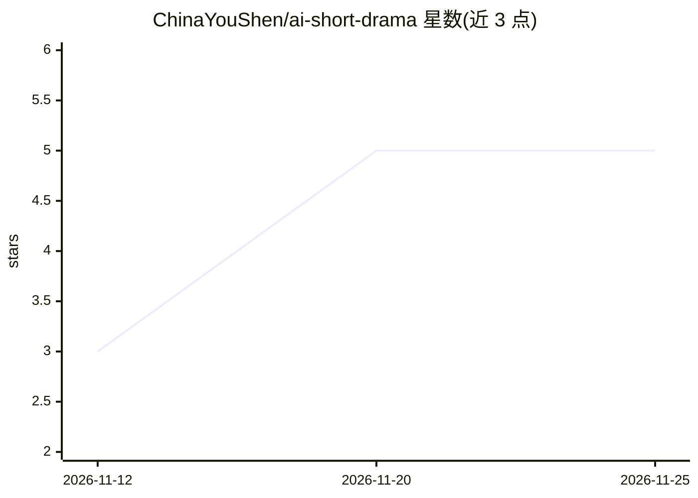

# ChinaYouShen/ai-short-drama

⭐ 5 · Python · GPL-3.0 · 推送 2026-11-21 · [GitHub](https://github.com/ChinaYouShen/ai-short-drama) · [官网](https://www.fzgcwl.com) · 个人维护 · 中文 README

**给 AI 用的中文短剧创作技能包：从选题到分镜提示词**

一套以 Markdown 规则文件组织的技能包，需交给能读文件的 AI（豆包、Cursor、Codex、WorkBuddy、文心一言、DeepSeek Harness）使用，本身不安装软件、不调用接口。流程覆盖选题、大纲、人物、剧本、对白、钩子、审稿、分镜、提示词、武戏、预算等环节，每环可单独进入。特色是武戏规范：每一招对应可画出的特效主体，现收 221 招，规矩写进参数表与检查脚本，附带 python3 自检脚本（零依赖）。GPL-3.0 许可，简体中文。

## 筛选速览

| 维度 | 判定 | 备注 |
|---|---|---|
| AI 角色 | `ai-knowledge` | 知识聚合/清单类 |
| 许可风险 | `viral` | GPL-3.0 |
| 部署形态 | `None` |  |
| 模型依赖 | — | README 未给出锁定关系 |
| 硬件要求 | — | 无带数字的原话,不猜 |
| 安装摩擦 | `low` | 无编译、无系统依赖或容器化 |
| 成熟度 | — | 结构信号不足 |

## 能力要点

- 覆盖选题→大纲→剧本→分镜→提示词→预算的 12 个环节，支持任意一环单独进入
- 武戏规范要求每招对应可画出的特效主体，现收 221 招
- 适配豆包/Cursor/Codex/文心一言/DeepSeek Harness 等平台（adapters/ 目录）
- python3 scripts/check.py 零依赖自检：样例、221 招体检、文档断链

## 适用场景

- 让 AI 生成 60 秒短剧剧本并留钩子
- 把小说或原作改编成分镜与图片提示词
- 对已有剧本做审稿、打分与诊断
- 为武戏打斗镜头挑选招式并生成特效提示词

## 场景标签

`提示工程` `AI 写作` `视频生成` · 领域:Agent 开发

## 证据(README 行号)

> L3: 给会读文件的 AI 用的一套短剧规矩。它不装软件、不调接口，只负责把你想要的东西写成能直接用的文字和提示词。
> L7: - 可用：豆包、Cursor、Codex、WorkBuddy、文心一言、DeepSeek Harness
> L11: 选题 → 大纲 → 人物 → 资产 → 剧本 → 对白 → 钩子 → 审稿 → 分镜 → 提示词 → 武戏 → 预算，任意一环都能单独进入，不必从头跑。

## 星数曲线

2026-11-12 3 → 2026-11-25 5（+2）

---
*卡片 v1 · prompt 1.4 · 生成 2026-11-21 · 置信度 high · 依据 README sha `fe097f0f4a61` · [字段定义](../../DATASET.md)*
