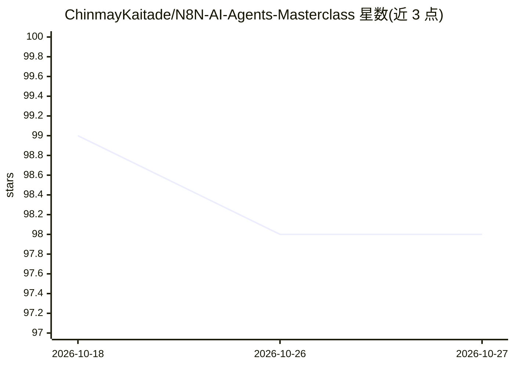

# ChinmayKaitade/N8N-AI-Agents-Masterclass

⭐ 98 · HTML · MIT · 推送 2025-11-09 · [GitHub](https://github.com/ChinmayKaitade/N8N-AI-Agents-Masterclass) · [官网](https://docs.n8n.io/) · 个人维护 · 中文 README

**30 天学习 n8n 与 AI Agent 的教程仓库（含工作流 JSON 示例）**

记录 N8N AI Agents Masterclass（印地语授课）30 天学习路线的教程仓库：每天对应一个文件夹，含笔记、示例工作流与 JSON 文件，内容从 n8n 基础、节点类型、自托管对比，到客户反馈 Agent、邮件自动回复、RAG 知识库、语音 Agent、MCP 集成与 WhatsApp Agent。另附 1000+ 现成工作流 JSON 合集、Google Drive 笔记与 YouTube 教程链接。仓库本身不含可运行代码，安装与运行需自行使用 n8n。

## 筛选速览

| 维度 | 判定 | 备注 |
|---|---|---|
| AI 角色 | `ai-knowledge` | 知识聚合/清单类 |
| 许可风险 | `permissive` | MIT |
| 部署形态 | `None` |  |
| 模型依赖 | — | README 未给出锁定关系 |
| 硬件要求 | — | 无带数字的原话,不猜 |
| 安装摩擦 | `low` | 无编译、无系统依赖或容器化 |
| 成熟度 | — | 结构信号不足 |

## 能力要点

- 30 天分日学习路线，每天对应独立文件夹与笔记/工作流
- 覆盖 RAG、语音 Agent、MCP、WhatsApp Agent 等进阶主题
- 附 1000+ 工作流 JSON 合集与 PDF/Markdown 笔记

## 适用场景

- 跟随 30 天路线系统学习 n8n 自动化与 AI Agent 构建
- 获取现成 JSON 工作流作为自己项目的起点
- 查阅 RAG、MCP、语音 Agent 等专题的实践笔记

## 场景标签

`教程课程` `工作流自动化` · 领域:效率与自动化

## 证据(README 行号)

> L5: A complete 30-Day hands-on roadmap to learn and build automation-powered AI Agents using **n8n**.
> L27: This repository documents each day of learning from the **N8N AI Agents Masterclass** — covering automation, AI wor
> L76: - 1000+ Workflow Bundle — Includes JSON workflows for 1000+ automation projects

## 星数曲线

2026-10-18 99 → 2026-10-27 98（-1）

---
*卡片 v1 · prompt 1.4 · 生成 2026-10-23 · 置信度 high · 依据 README sha `54b6b65e6eee` · [字段定义](../../DATASET.md)*
