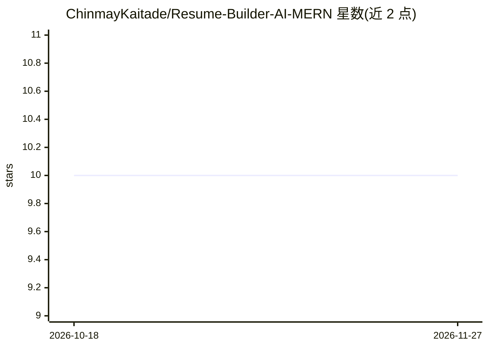

# ChinmayKaitade/Resume-Builder-AI-MERN

⭐ 10 · JavaScript · MIT · 推送 2026-03-17 · [GitHub](https://github.com/ChinmayKaitade/Resume-Builder-AI-MERN) · [官网](https://resume-builder-ai-mern.vercel.app/) · 个人维护

**求职者用 MERN+Gemini AI 生成与导出简历的 Web 应用**

基于 MERN（React、Node.js、Express、MongoDB）与 TailwindCSS 的简历构建 Web 应用。提供简历的完整增删改查、多模板、实时预览与多份简历管理，并接入 Gemini Flash 2.5 API 自动生成职业摘要、技能、工作经历要点与项目描述，支持上传简历生成 AI 建议。JWT 认证保护私有简历，公开链接可分享，支持 PDF 导出。前端部署于 Vercel，后端部署于 Render，本地运行需自备 MongoDB 连接串与 Gemini API key。

## 筛选速览

| 维度 | 判定 | 备注 |
|---|---|---|
| AI 角色 | `ai-native` | 本体是模型或模型工具 |
| 许可风险 | `permissive` | MIT |
| 部署形态 | `library` | 以包/库形式分发 |
| 模型依赖 | — | README 未给出锁定关系 |
| 硬件要求 | — | 无带数字的原话,不猜 |
| 安装摩擦 | `low` | 无编译、无系统依赖或容器化 |
| 成熟度 | — | 结构信号不足 |

## 能力要点

- 接入 Gemini Flash 2.5 API 生成摘要、技能与工作经历内容
- 简历完整 CRUD、多模板、实时预览与多份简历管理
- JWT 认证的 REST API，含公开简历链接
- PDF 导出与图片上传（Multer）

## 适用场景

- 快速生成带 AI 润色的求职简历
- 集中管理和更新多份简历并导出 PDF
- 通过公开链接分享简历给他人查看

## 场景标签

`AI 写作` · 领域:内容生成

## 证据(README 行号)

> L28: **Resume-Builder MERN** is a modern web application designed to help users build professional resumes with ease.
> L50: - Gemini Flash 2.5 API
> L169: ### 🤖 **AI Routes (Gemini Flash 2.5 Integrated)** (`/api/ai`)

## 星数曲线

2026-10-18 10 → 2026-11-27 10（+0）

---
*卡片 v1 · prompt 1.4 · 生成 2026-11-27 · 置信度 high · 依据 README sha `29425b420835` · [字段定义](../../DATASET.md)*
