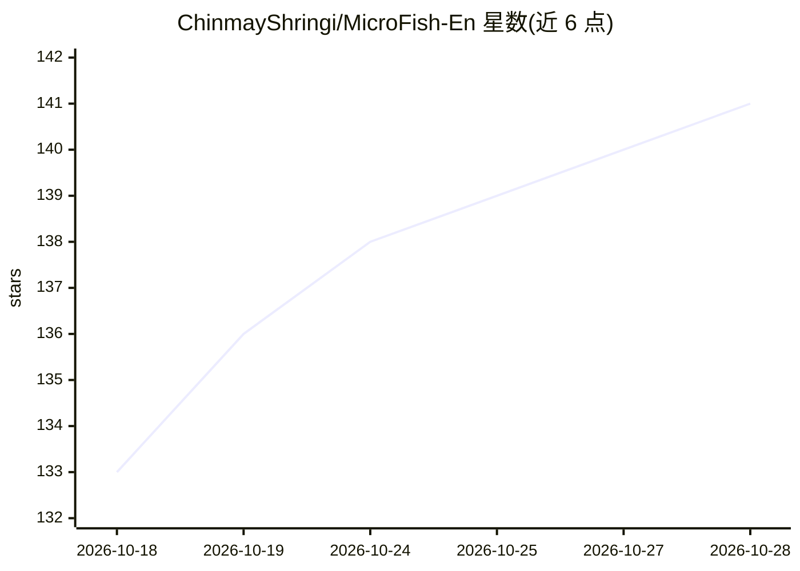

# ChinmayShringi/MicroFish-En

⭐ 142 · Python · AGPL-3.0 · 推送 2026-04-19 · [GitHub](https://github.com/ChinmayShringi/MicroFish-En) · 组织维护 · 中文 README

**面向预测任务的多智能体社会模拟引擎，生成预测报告**

本仓库为 MiroFish 的英文翻译版。用户上传种子材料（新闻、报告、小说文本等）并以自然语言描述预测需求，系统据此构建 GraphRAG 与人格化智能体，在双平台上运行数千个智能体的社会演化模拟，通过 ReportAgent 生成预测报告，并支持与模拟世界中任意智能体及 ReportAgent 深度对话。模拟引擎基于 OASIS，LLM 接入要求 OpenAI SDK 格式 API（推荐通义千问-plus），README 提示 token 消耗高、建议先跑 40 轮以内。提供源码部署（Node.js 18+/Python 3.11-3.12/uv）与 Docker Compose 两种方式，由盛大集团孵化。

## 筛选速览

| 维度 | 判定 | 备注 |
|---|---|---|
| AI 角色 | `ai-native` | 本体是模型或模型工具 |
| 许可风险 | `viral` | AGPL-3.0 |
| 部署形态 | `self-host` | docker 或自建部署 |
| 模型依赖 | — | README 未给出锁定关系 |
| 硬件要求 | — | 无带数字的原话,不猜 |
| 安装摩擦 | `low` | 无编译、无系统依赖或容器化 |
| 成熟度 | — | 结构信号不足 |

## 能力要点

- 从种子材料自动构建 GraphRAG 与人格化智能体并并行模拟
- ReportAgent 生成预测报告，支持与任意模拟智能体对话
- 双平台并行模拟与动态时序记忆更新
- 模拟引擎基于 CAMEL-AI 的 OASIS

## 适用场景

- 对舆情、政策、金融等事件做模拟推演并获取预测报告
- 以‘上帝视角’注入变量，推演不同未来走向
- 基于小说文本推演剧情结局（如红楼梦后四十回）

## 场景标签

`多智能体` · 领域:Agent 开发

## 证据(README 行号)

> L21: **MiroFish** is a next-generation AI prediction engine powered by multi-agent technology. By extracting seed inform
> L68: 1. **Graph Building**: Seed extraction & Individual/collective memory injection & GraphRAG construction
> L71: 4. **Report Generation**: ReportAgent with rich toolset for deep interaction with post-simulation environment

## 星数曲线

2026-10-18 133 → 2026-10-28 141（+8）

---
*卡片 v1 · prompt 1.4 · 生成 2026-10-22 · 置信度 high · 依据 README sha `05555e473c63` · [字段定义](../../DATASET.md)*
