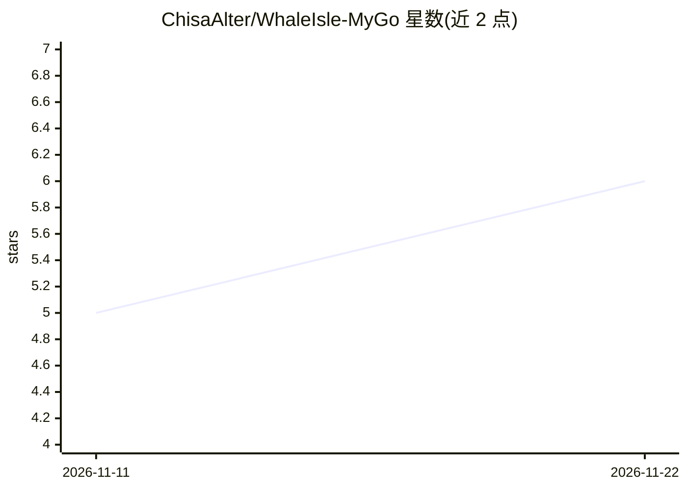

# ChisaAlter/WhaleIsle-MyGo

⭐ 6 · Go · MIT · 推送 2026-11-21 · [GitHub](https://github.com/ChisaAlter/WhaleIsle-MyGo) · 个人维护 · 中文 README

**把 DeepSeek Harness 做成原生桌面客户端的 AI 编码工作台**

基于 DeepSeek Harness 的 Go 原生桌面客户端，用内置 MyGo 图形引擎绘制界面，省去浏览器渲染进程。功能覆盖对话式读写文件与运行命令、多成员协作的 Project 模式（协调者拆解任务、审批卡片控制权限）、Git 差异审阅、内嵌终端、SSH 远程工作区、MCP 与插件市场。数据保存在本机，安装包内置运行时；社区独立维护，非 DeepSeek 官方产品，模型调用费用由用户自配的服务商收取。

## 筛选速览

| 维度 | 判定 | 备注 |
|---|---|---|
| AI 角色 | `ai-native` | 本体是模型或模型工具 |
| 许可风险 | `permissive` | MIT |
| 部署形态 | `desktop` | 安装包/桌面程序 |
| 模型依赖 | locked-api |  |
| 硬件要求 | — | 无带数字的原话,不猜 |
| 安装摩擦 | `low` | 无编译、无系统依赖或容器化 |
| 成熟度 | `idea` | |

## 能力要点

- Project 多成员协作：协调者拆解任务，权限操作需单次审批
- Go + MyGo 原生图形引擎绘制界面，无浏览器渲染进程
- 文件编辑、Git Diff、内嵌终端与对话并列的工作台布局
- 内置技能管理、MCP 服务配置与插件市场

## 适用场景

- 在本机一个窗口里和模型一起改代码并审阅 Git 差异
- 把本地代码库交给 AI 团队长期推进目标
- 连接 SSH 远程开发机目录进行浏览与对话

## 场景标签

`编码 Agent` `多智能体` · 领域:Agent 开发

## 证据(README 行号)

> L25: 鲸屿 MyGo 把 DeepSeek Harness 做成开箱即用的**原生桌面应用**：界面由 Go 与内置的 MyGo 原生图形引擎直接绘制，省去了主窗口的浏览器渲染进程，启动更快、常驻内存更省；服务在本机运行，数据保存在本机
> L32: |把一件事交给 AI 团队|**Project**：说目标，协调者与成员分头推进，只在需要你拍板时才打扰你|
> L31: |和模型一起改代码|对话里直接读写文件、搜索仓库、运行命令；需要更高权限的操作先请你批准|

## 星数曲线

2026-11-11 5 → 2026-11-22 6（+1）

---
*卡片 v1 · prompt 1.4 · 生成 2026-11-21 · 置信度 high · 依据 README sha `2159cbc3346c` · [字段定义](../../DATASET.md)*
