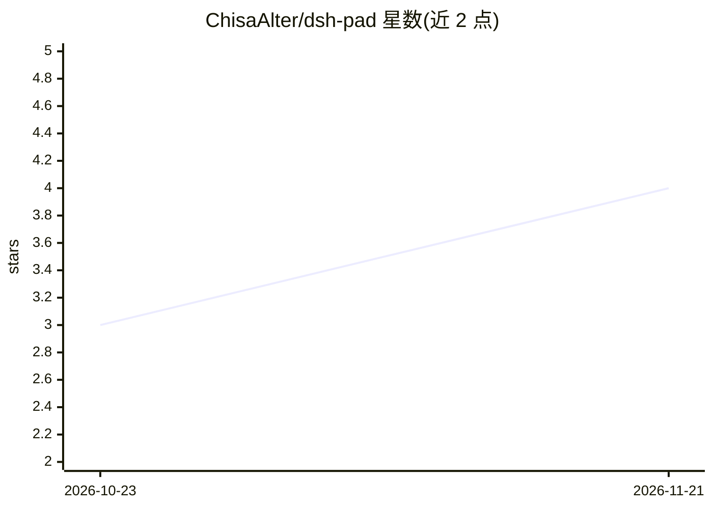

# ChisaAlter/dsh-pad

⭐ 4 · TypeScript · MIT · 推送 2026-11-19 · [GitHub](https://github.com/ChisaAlter/dsh-pad) · [官网](https://github.com/ChisaAlter/dsh-pad#readme) · 个人维护 · 中文 README

**DSH 的 AI 生成悬浮面板插件：对话建面板、平铺组合**

DeepSeek Harness（dsh）的插件，在对话中由模型通过 `pad_*` 工具生成沙箱 iframe 运行的 HTML/CSS/JS 面板卡片。面板支持悬浮球收起、自由拖拽分区嵌套、亮暗主题跟随。取数有两种路径：本机 shell/HTTP 直接数据源按秒级刷新，或 AI 刷新由后台 agent 周期取数；面板内还可通过 `dsh.run` 调模型。内置确定性排版 lint、密钥环境变量解析、GitHub Release 自动更新。依赖 dsh ≥ 0.2.1-rc.2，以 bundle 方式登记安装，MIT 许可。

## 筛选速览

| 维度 | 判定 | 备注 |
|---|---|---|
| AI 角色 | `ai-enhanced` | 去掉 AI 部分产品仍成立 |
| 许可风险 | `permissive` | MIT |
| 部署形态 | `library` | 以包/库形式分发 |
| 模型依赖 | — | README 未给出锁定关系 |
| 硬件要求 | — | 无带数字的原话,不猜 |
| 安装摩擦 | `low` | 无编译、无系统依赖或容器化 |
| 成熟度 | — | 结构信号不足 |

## 能力要点

- AI 通过 `pad_*` 工具（9 个）在对话里创建/修改面板，带确定性排版 lint
- 两种取数：本机命令/HTTP 直接数据源不耗 token；AI 刷新支持多步推理取数
- 沙箱 iframe（`default-src 'none'`，无网络、无 cookie）运行面板脚本
- 面板内 `dsh.run` 用面板自选模型做纯文本生成，支持逐面板指定模型

## 适用场景

- 在对话里说一句就生成服务器性能监控面板，每 3 秒刷新
- 显示 DeepSeek API 余额或 GitHub 最新 Release 的悬浮卡片
- 用 AI 刷新定时抓取需要搜索、读网页才能拿到数据
- 把多张数据卡片自由分区组合成个人监控坞

## 场景标签

`代码生成` `数据分析` · 领域:效率与自动化

## 证据(README 行号)

> L9: DeepSeek Harness（dsh）的悬浮面板插件。面板由 AI 在对话里生成：比如「做一个观察这台服务器性能的面板」「做一个面板显示我的 DeepSeek API 余额」。
> L12: - **AI 生成**：模型通过 `pad_*` 工具创建和修改面板。面板是跑在沙箱 iframe 里的 HTML / CSS / JS，颜色跟随 dsh 的亮色 / 暗色主题。
> L141: - **AI 刷新**：后台 agent 默认使用 dsh 的默认模型和默认 agent 预设（有 web_fetch / web_search 等工具），另外只多两个工具：`pad_submit_data` 和 `pad_re

## 星数曲线

2026-10-23 3 → 2026-11-21 4（+1）

---
*卡片 v1 · prompt 1.4 · 生成 2026-11-21 · 置信度 high · 依据 README sha `a297f9f53e71` · [字段定义](../../DATASET.md)*
