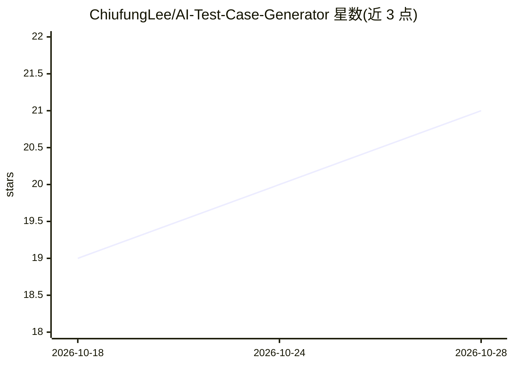

# ChiufungLee/AI-Test-Case-Generator

⭐ 21 · Python · MIT · 推送 2026-10-24 · [GitHub](https://github.com/ChiufungLee/AI-Test-Case-Generator) · [官网](http://106.13.192.72:8000/) · 个人维护 · 中文 README

**面向测试工程师的 RAG+LLM 测试用例生成与测试辅助平台**

基于 FastAPI + LangChain + LangGraph + ChromaDB 的 Web 平台，服务软件测试人员：上传 PDF 需求/产品文档构建可检索知识库，结合 RAG 进行场景化对话（需求澄清/产品指南/运维助手）；提供 LangGraph 编排的结构化工作流（需求分析→人工确认→用例生成→覆盖检查），产物按版本落库；另含测试用例集管理（编辑/版本对比/回滚/AI 修改）、OpenAPI 导入的接口测试与批量执行、CSV 导出。需自备 LLM 与 Embedding API（示例配置为 DeepSeek 与阿里百炼），生产部署要求单 worker。

## 筛选速览

| 维度 | 判定 | 备注 |
|---|---|---|
| AI 角色 | `ai-native` | 本体是模型或模型工具 |
| 许可风险 | `permissive` | MIT |
| 部署形态 | `library` | 以包/库形式分发 |
| 模型依赖 | locked-api |  |
| 硬件要求 | — | 无带数字的原话,不猜 |
| 安装摩擦 | `low` | 无编译、无系统依赖或容器化 |
| 成熟度 | — | 结构信号不足 |

## 能力要点

- PDF 文档向量化入库，RAG 检索结合 LLM 生成测试用例
- LangGraph 编排需求分析→人工确认→用例生成→覆盖检查工作流，断点可恢复
- 覆盖检查不经 LLM，用集合运算 + RapidFuzz 相似度查重
- 接口测试：OpenAPI 导入→规则引擎/AI 生成用例→批量执行与响应断言

## 适用场景

- 上传需求文档让 AI 梳理测试点并生成测试用例
- 基于产品文档构建知识库，回答使用与排障问题
- 从 OpenAPI 文档批量生成并执行接口测试用例
- 长期管理测试用例资产：版本对比、回滚、AI 修改

## 场景标签

`RAG` `文档问答` · 领域:知识与检索

## 证据(README 行号)

> L18: 系统基于 **FastAPI + LangChain + LangGraph + RAG + ChromaDB + LLM** 构建，支持上传 PDF 产品/需求文档，将文档转换为可检索的知识库，并结合大语言模型完成：
> L21: - 结构化测试工作流：需求分析 → 人工确认 → 用例生成 → 覆盖检查（LangGraph 编排，产物按版本落库）
> L43: |🔌 接口测试|OpenAPI/Swagger 导入（URL 可同步 / 粘贴可重新解析）→ Schema 规则引擎确定性生成用例（正常 / 缺失必填 / 类型错误 / 越界 / 非法枚举 / 违反格式，并自动派生响应断言）→ A

## 星数曲线

2026-10-18 19 → 2026-10-28 21（+2）

---
*卡片 v1 · prompt 1.4 · 生成 2026-10-28 · 置信度 mid · 依据 README sha `a09fa192590f` · [字段定义](../../DATASET.md)*
