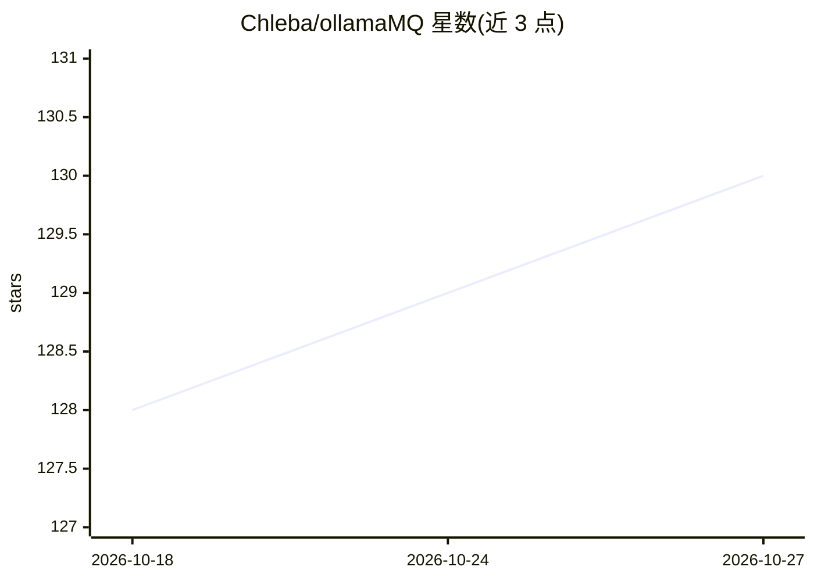

# Chleba/ollamaMQ

⭐ 130 · Rust · MIT · 推送 2026-10-13 · [GitHub](https://github.com/Chleba/ollamaMQ) · 个人维护

**面向多用户的 Ollama/LM Studio 后端代理与公平排队调度器**

用 Rust 编写的异步消息队列调度器与负载均衡器，部署在一个或多个 Ollama/LM Studio/OpenAI 兼容实例之前：按 X-User-ID 为每个用户维护 FIFO 队列，以公平份额轮转调度并行分发请求，并按已加载模型优先做感知路由；同时聚合各后端模型列表、每 10 秒并发健康检查、提供实时 TUI 面板与管理 API 直接加载/卸载后端模型。还支持 System One 决策模型后端族（仅路由 /v1/systemone）。安装方式为 cargo install、源码编译或 Docker。

## 筛选速览

| 维度 | 判定 | 备注 |
|---|---|---|
| AI 角色 | `ai-ecosystem` | LLM/agent 周边工具 |
| 许可风险 | `permissive` | MIT |
| 部署形态 | `self-host` | docker 或自建部署 |
| 模型依赖 | local-ok | 支持本地模型 |
| 硬件要求 | — | 无带数字的原话,不猜 |
| 安装摩擦 | `low` | 无编译、无系统依赖或容器化 |
| 成熟度 | — | 结构信号不足 |

## 能力要点

- 公平份额调度：按用户近期负载衰减计分，防止单用户独占后端
- 模型感知路由：优先路由到已加载该模型的后端，避免冷启动与驱逐
- 聚合模型列表：/api/tags 与 /v1/models 由代理合并所有兼容后端
- 实时 TUI 面板监控后端健康、队列深度与吞吐，支持 VIP/Boost 优先级

## 适用场景

- 团队多人共享有限的 Ollama/LM Studio 后端时做排队与公平调度
- 把多个本地 LLM 实例聚合成一个端点供 OpenAI 兼容客户端使用
- 在界面上直接加载/卸载后端模型并监控各实例状态

## 场景标签

`模型网关` · 领域:Agent 开发

## 证据(README 行号)

> L3: `ollamaMQ` is a high-performance, asynchronous message queue dispatcher and load balancer designed to sit in front o
> L11: - **Multi-Backend Load Balancing**: Distribute requests across multiple Ollama or LM Studio instances using a **Lea

## 星数曲线

2026-10-18 128 → 2026-10-27 130（+2）

---
*卡片 v1 · prompt 1.4 · 生成 2026-10-23 · 置信度 high · 依据 README sha `e8ad68f11266` · [字段定义](../../DATASET.md)*
