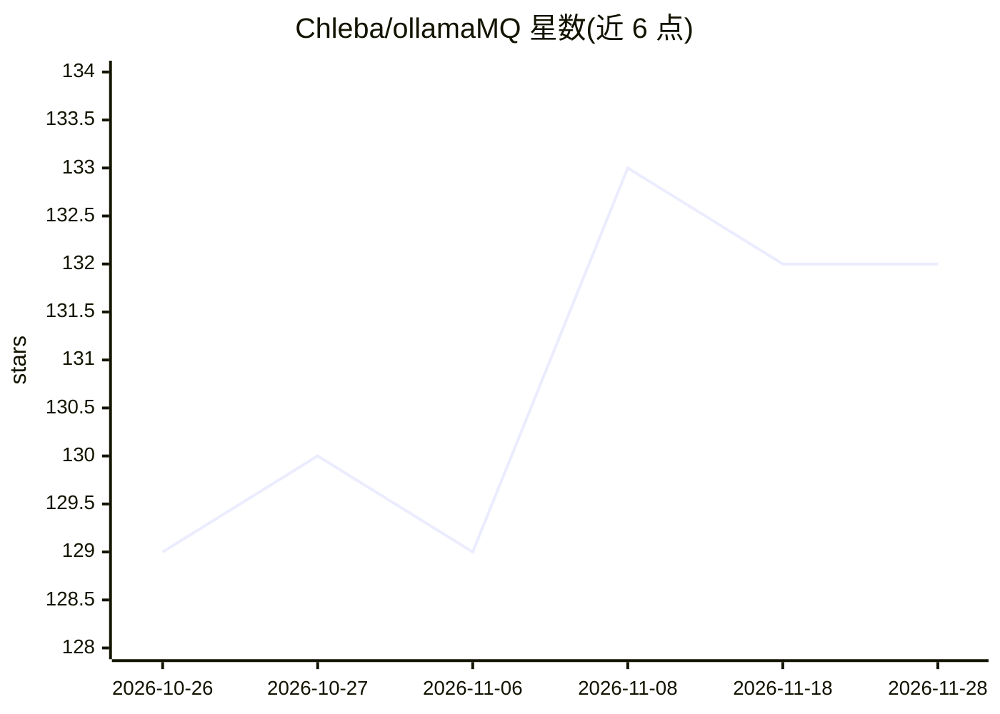

# Chleba/ollamaMQ

⭐ 132 · Rust · MIT · 推送 2026-10-30 · [GitHub](https://github.com/Chleba/ollamaMQ) · 个人维护

**为多用户多后端 LLM API 提供排队调度与负载均衡的代理**

用 Rust 编写的异步消息队列调度器与负载均衡器，部署在多个 Ollama、LM Studio 或 vLLM 风格后端之前：按用户（X-User-ID 头）维护 FIFO 队列，用公平分享轮询调度加最少连接策略向后端并行分发请求，并按模型名称做路由。提供实时 TUI 仪表盘查看后端健康、队列深度与吞吐，支持从 TUI 或管理 API 加载/卸载后端模型，聚合多个后端的模型列表，并兼容 OpenAI 端点。需 Rust 与 Ollama 环境，可经 Cargo、源码或 Docker 运行。

## 筛选速览

| 维度 | 判定 | 备注 |
|---|---|---|
| AI 角色 | `ai-ecosystem` | LLM/agent 周边工具 |
| 许可风险 | `permissive` | MIT |
| 部署形态 | `self-host` | docker 或自建部署 |
| 模型依赖 | local-ok | 支持本地模型 |
| 硬件要求 | — | 无带数字的原话,不猜 |
| 安装摩擦 | `low` | 无编译、无系统依赖或容器化 |
| 成熟度 | — | 结构信号不足 |

## 能力要点

- 按用户公平分享调度：评分每 5 分钟减半，防止单一用户占满后端
- 模型感知路由：请求只发往列出该模型且已加载的后端
- 聚合 /api/tags 与 /v1/models，合并去重所有兼容后端的模型列表
- 实时 TUI 仪表盘与管理 API 支持后端模型加载/卸载

## 适用场景

- 多个用户共用一批本地 Ollama/LM Studio 后端时排队与公平分配
- 把多个后端聚合为一个 OpenAI 兼容入口供客户端接入
- 通过仪表盘监控后端健康与队列状态并远程加载/卸载模型

## 场景标签

`模型网关` · 领域:Agent 开发

## 证据(README 行号)

> L3: `ollamaMQ` is a high-performance, asynchronous message queue dispatcher and load balancer designed to sit in front o
> L21: - **Per-User Queuing**: Each user (identified by the `X-User-ID` header) has their own FIFO queue, capped at 100 wa
> L27: - **OpenAI Compatibility**: Supports standard OpenAI-compatible endpoints.

## 星数曲线

2026-10-26 129 → 2026-11-28 132（+3）

---
*卡片 v1 · prompt 1.4 · 生成 2026-11-28 · 置信度 high · 依据 README sha `6273f41ea52d` · [字段定义](../../DATASET.md)*
