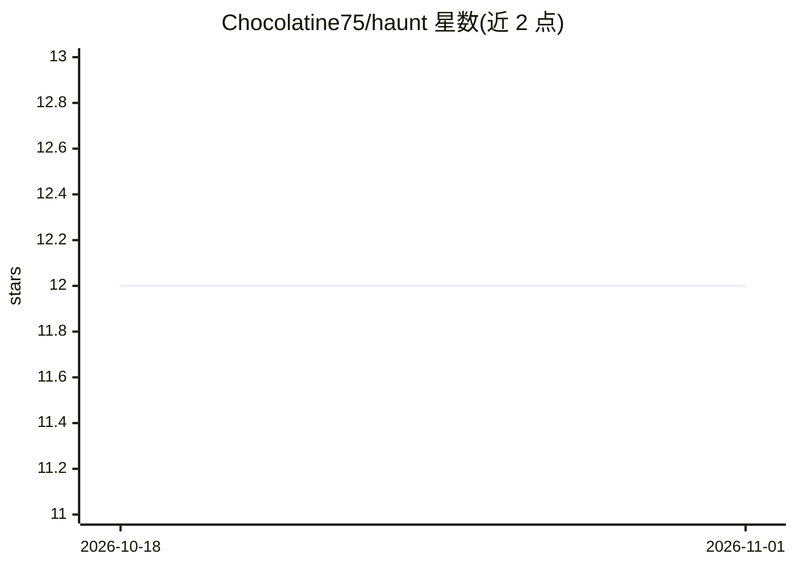

# Chocolatine75/haunt

⭐ 12 · TypeScript · MIT · 推送 2026-10-19 · [GitHub](https://github.com/Chocolatine75/haunt) · 个人维护

**Claude Code 插件：派 AI 幽灵用户以真人方式测试你的应用**

以 Claude Code 插件形式提供的 Web 应用测试工具：在真实 Chromium 浏览器中运行多个 AI 驱动的虚拟用户人格（困惑的新手、恶意输入者、仅键盘操作的无障碍用户等），读取应用 DOM 与可访问性树探索页面，偏离正常操作路径寻找缺陷，输出带 YAML frontmatter 的结构化 Markdown 报告。报告末尾附 'For Claude' 段落，可粘贴到提示词中让 Claude Code 按严重度修复问题。支持自定义人格（YAML）。需 Claude Code 与 Node.js 18+，Chromium 首次运行时自动安装。

## 筛选速览

| 维度 | 判定 | 备注 |
|---|---|---|
| AI 角色 | `ai-ecosystem` | LLM/agent 周边工具 |
| 许可风险 | `permissive` | MIT |
| 部署形态 | `None` |  |
| 模型依赖 | locked-api |  |
| 硬件要求 | — | 无带数字的原话,不猜 |
| 安装摩擦 | `low` | 无编译、无系统依赖或容器化 |
| 成熟度 | — | 结构信号不足 |

## 能力要点

- 3 种内置虚拟用户人格（困惑新手/恶意用户/仅键盘用户）
- 真实 Chromium 浏览器读取可访问性树驱动 AI 行为
- 报告含 'For Claude' 段落，可一条提示词修复全部问题
- 支持 YAML 自定义测试人格

## 适用场景

- 上线前用 AI 模拟真实用户的破坏性操作找 bug
- 生成可直接交给 Claude Code 修复的结构化缺陷报告
- 测试表单校验、无障碍标注等边角缺陷

## 场景标签

`浏览器自动化` · 领域:效率与自动化

## 证据(README 行号)

> L3: **A Claude Code plugin that tests your app the way real users break it.**
> L17: **Haunt fixes this.** It unleashes AI phantom users on your app while you build — a confused beginner, a user who b
> L102: No AI vision. No magic. Just a real browser reading your accessibility tree — and an AI deciding what a confused u

## 星数曲线

2026-10-18 12 → 2026-11-01 12（+0）

---
*卡片 v1 · prompt 1.4 · 生成 2026-11-01 · 置信度 high · 依据 README sha `19f52182c74c` · [字段定义](../../DATASET.md)*
