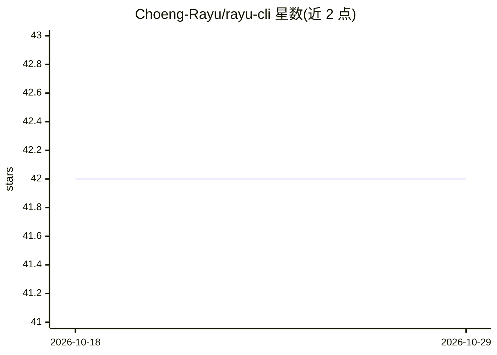

# Choeng-Rayu/rayu-cli

⭐ 42 · TypeScript · MIT · 推送 2026-10-17 · [GitHub](https://github.com/Choeng-Rayu/rayu-cli) · [官网](https://rayucode.com) · 个人维护

**终端 AI 编程 agent CLI，多提供商接入与本地模型支持**

npm 分发的命令行 AI 编程 agent：通过 BYOK 自带 API key 接入 Anthropic、OpenAI、DeepSeek、Gemini、Kimi 等提供商，也支持经 Ollama/LM Studio 运行本地模型，可在会话中用 /model 切换模型。提供 P2P 实时协作、并行 Agent Swarms、MCP 与专用 agent。仓库为 monorepo，含 CLI（TypeScript+Bun+Ink）、NestJS 账户后端、Go AI 网关与 Next.js 站点四个服务，可从源码分别运行。注意 README 含大量营销式对比表述，事实性裁决以可验证条目为准。

## 筛选速览

| 维度 | 判定 | 备注 |
|---|---|---|
| AI 角色 | `ai-native` | 本体是模型或模型工具 |
| 许可风险 | `permissive` | MIT |
| 部署形态 | `self-host` | docker 或自建部署 |
| 模型依赖 | local-ok | 支持本地模型 |
| 硬件要求 | — | 无带数字的原话,不猜 |
| 安装摩擦 | `low` | 无编译、无系统依赖或容器化 |
| 成熟度 | — | 结构信号不足 |

## 能力要点

- 多提供商 BYOK 接入：Anthropic/OpenAI/DeepSeek/Gemini/Kimi 等
- 经 Ollama/LM Studio 支持本地模型，含离线能力
- 原生 P2P 协作与并行 Agent Swarms
- Monorepo 四服务：CLI、账户后端、Go AI 网关、Web 站点

## 适用场景

- 在终端里用自然语言让 agent 修改代码库
- 用自己的 API key 或本地模型进行 AI 编程，不经过托管方
- 团队成员通过 P2P 在同一终端会话协作

## 场景标签

`编码 Agent` `模型网关` · 领域:Agent 开发

## 证据(README 行号)

> L3: **The AI Coding Agent Ecosystem**
> L54: Rayu works perfectly right out of the box. Switch models instantly mid-session with `/model` or run parallel diagno

## 星数曲线

2026-10-18 42 → 2026-10-29 42（+0）

---
*卡片 v1 · prompt 1.4 · 生成 2026-10-25 · 置信度 mid · 依据 README sha `50b307520a1d` · [字段定义](../../DATASET.md)*
