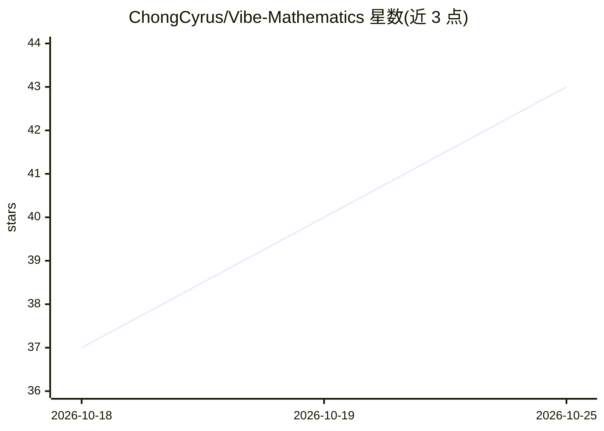

# ChongCyrus/Vibe-Mathematics

⭐ 43 · JavaScript · MIT · 推送 2026-10-24 · [GitHub](https://github.com/ChongCyrus/Vibe-Mathematics) · 个人维护 · 中文 README

**DeepSeek Harness 上的多代理数学求解与交叉验证插件预设**

以 npm 插件包（dsh-vibe-math）形式发布、运行在 DeepSeek Harness（DSH）内的一组 agent preset（v2-v5 四代架构），用多代理协作自动求解数学问题并对结论做多代理交叉验证。v2 为概率驱动 JSON 数据层，v3 引入规划代理与论文式 Markdown 知识库，v4/v5（实验性）为常驻自组织/研究所体系，结论需全体或 m 票布尔一致才写入 Verified/。四套共享断点续跑、中途人工干预与自然语言控制底座。另提供可开关的 Lean 形式化验证（框架不内置 Lean 工具链）。v2-v5 及 v5r 旧 preset 已标记弃用，方向改为 vibe-math-vmu+pack。

## 筛选速览

| 维度 | 判定 | 备注 |
|---|---|---|
| AI 角色 | `ai-ecosystem` | LLM/agent 周边工具 |
| 许可风险 | `permissive` | MIT |
| 部署形态 | `library` | 以包/库形式分发 |
| 模型依赖 | locked-api |  |
| 硬件要求 | — | 无带数字的原话,不猜 |
| 安装摩擦 | `low` | 无编译、无系统依赖或容器化 |
| 成熟度 | `idea` | |

## 能力要点

- 四代求解架构（概率驱动/规划代理/常驻自组织/研究所体系），结论需多代理一致才入 Verified/
- 断点续跑、中途人工干预、进度汇报、自然语言驱动的共享底座
- 可开关的 Lean 形式化验证（off/encourage/require 三档，含忠实性审查与回执通道）
- 收口时自动产出最终论文（md/tex/PDF，PDF 需宿主 LaTeX 引擎）

## 适用场景

- 让多个 AI 代理协作求解数学问题并交叉验证结论
- 以形式化验证（Lean）对数学结论做机器核对
- 通过自然语言驱动数学研究流程并随时人工干预

## 场景标签

`多智能体` `科研工具` · 领域:Agent 开发

## 证据(README 行号)

> L9: > 运行在 **DeepSeek Harness** 内的一组 **agent preset**（`vibe-math-v2` / `vibe-math-v3` / `vibe-math-v4` / `vibe-math-v5`），
> L19: 安装本插件包（或手动复制预设）后，DSH 的预设选择器里会出现**四个** agent preset。
> L98: - **多代理自动求解**：主代理把问题交给调度器，调度器派发 explorer / solver / verifier（v2/v3）与 **planner（规划代理，v3）**、**method-keeper（方法整理代理，v3

## 星数曲线

2026-10-18 37 → 2026-10-25 43（+6）

---
*卡片 v1 · prompt 1.4 · 生成 2026-10-25 · 置信度 mid · 依据 README sha `86eddcbe56fe` · [字段定义](../../DATASET.md)*
