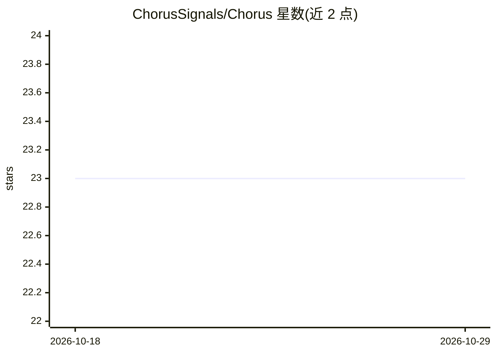

# ChorusSignals/Chorus

⭐ 23 · TypeScript · MIT · 推送 2026-06-22 · [GitHub](https://github.com/ChorusSignals/Chorus) · 组织维护

**Solana 聪明钱分群共识追踪工具，判断多群体是否真一致**

面向 Solana 链上交易操作者的钱包行为追踪工具：将做市商、基金、团队、交易者作为四个独立群体分别加权排名，检测同一代币与方向是否跨群体出现，并将对齐程度转换为 isolated/building/broad/crowded 四种共识状态；通过分层权重（tier1=3/tier2=2/tier3=1）与群体加成系数计算共识分，附带群体分离、迟到拥挤降级等风控规则。以 TypeScript/npm 项目形式提供，含 Live Agreement Wall 运行界面与 Agent 状态展示。

## 筛选速览

| 维度 | 判定 | 备注 |
|---|---|---|
| AI 角色 | `ai-enhanced` | 去掉 AI 部分产品仍成立 |
| 许可风险 | `permissive` | MIT |
| 部署形态 | `library` | 以包/库形式分发 |
| 模型依赖 | — | README 未给出锁定关系 |
| 硬件要求 | — | 无带数字的原话,不猜 |
| 安装摩擦 | `low` | 无编译、无系统依赖或容器化 |
| 成熟度 | — | 结构信号不足 |

## 能力要点

- 四群体（做市商/基金/团队/交易者）分离加权，避免单一群体库存偏差被误读为广泛共识
- 共识分 = 同向权重/追踪总权重，分层 tier 权重与群体加成系数
- 四种可命名共识状态：isolated/building/broad/crowded
- 信号降级规则：单一群体活跃、迟到拥挤、小簇反复出现等

## 适用场景

- 判断某个代币的聪明钱共识是跨群体真实扩散还是仅单一群体回声
- 追踪谁先建仓、谁随后确认、共识是否在变广
- 在多路钱包信号流中过滤单一噪音钱包的误导

## 场景标签

`金融量化` · 领域:学习与行业

## 证据(README 行号)

> L29: Live operating view for Chorus: lead token consensus card, four cohort sectors with active and idle smart-money wal
> L3: Cohort-consensus tracker for smart-money behavior on Solana.

## 星数曲线

2026-10-18 23 → 2026-10-29 23（+0）

---
*卡片 v1 · prompt 1.4 · 生成 2026-10-27 · 置信度 mid · 依据 README sha `9f0b57b3a08c` · [字段定义](../../DATASET.md)*
