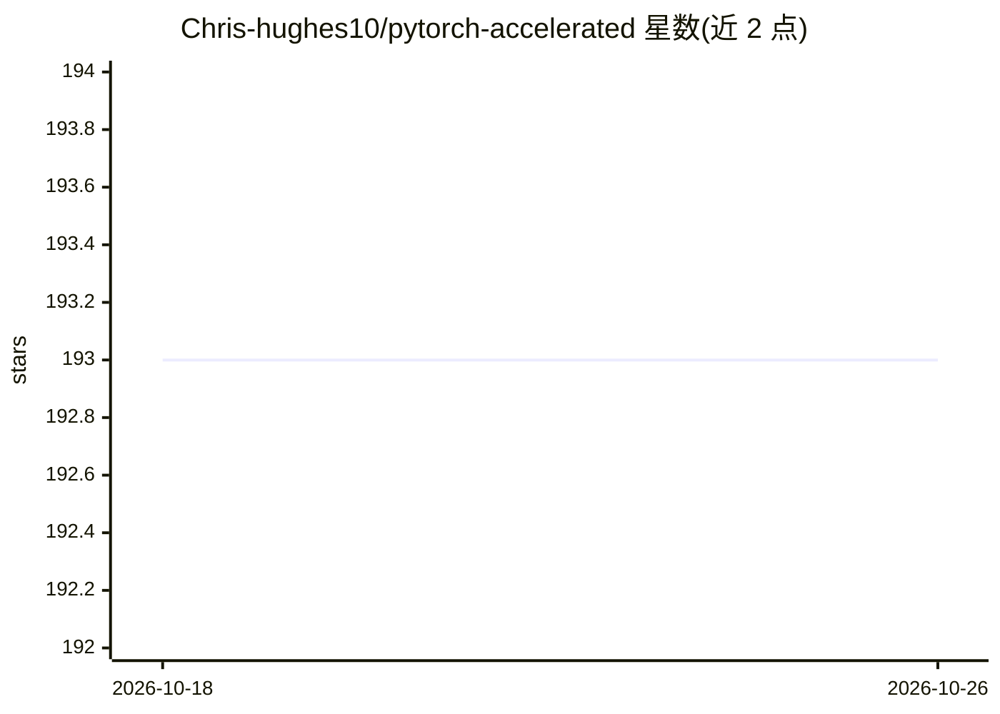

# Chris-hughes10/pytorch-accelerated

⭐ 193 · Python · Apache-2.0 · 推送 2026-02-27 · [GitHub](https://github.com/Chris-hughes10/pytorch-accelerated) · 个人维护

**轻量 PyTorch 训练循环库：免写样板代码，多硬件无需改代码**

为熟悉 PyTorch 的开发者提供的轻量训练库：将训练循环封装在单个 Trainer 类中，处理设备放置、混合精度、DeepSpeed 集成、多 GPU 与分布式训练，且切换硬件无需改代码。构建于 Hugging Face Accelerate 之上，使用纯 PyTorch 组件，可与 timm、transformers、torchmetrics 互操作，行为可通过继承与回调定制。仅覆盖训练过程，数据加载与推理由用户自行负责。通过 pip 安装，使用 accelerate CLI 或常规方式启动。

## 筛选速览

| 维度 | 判定 | 备注 |
|---|---|---|
| AI 角色 | `ai-ecosystem` | LLM/agent 周边工具 |
| 许可风险 | `permissive` | Apache-2.0 |
| 部署形态 | `library` | 以包/库形式分发 |
| 模型依赖 | — | README 未给出锁定关系 |
| 硬件要求 | — | 无带数字的原话,不猜 |
| 安装摩擦 | `low` | 无编译、无系统依赖或容器化 |
| 成熟度 | — | 结构信号不足 |

## 能力要点

- 单 Trainer 类封装可定制的训练循环，支持继承与回调扩展
- 设备放置、混合精度、DeepSpeed、多 GPU/分布式训练无需改代码
- 基于 Hugging Face Accelerate，使用纯 PyTorch 组件
- 与 timm、transformers、torchmetrics 互操作

## 适用场景

- 我熟悉 PyTorch，想省去编写训练循环样板代码
- 我希望同一份训练代码在 CPU/多 GPU 等不同硬件上运行
- 我需要一个行为透明、易于调试定制的训练循环

## 场景标签

`微调` · 领域:训练与推理

## 证据(README 行号)

> L27: `pytorch-accelerated` is a lightweight library designed to accelerate the process of training PyTorch models
> L38: - Handles device placement, mixed-precision, DeepSpeed integration, multi-GPU and distributed training with no code

## 星数曲线

2026-10-18 193 → 2026-10-26 193（+0）

---
*卡片 v1 · prompt 1.4 · 生成 2026-10-22 · 置信度 high · 依据 README sha `da26c235cd49` · [字段定义](../../DATASET.md)*
