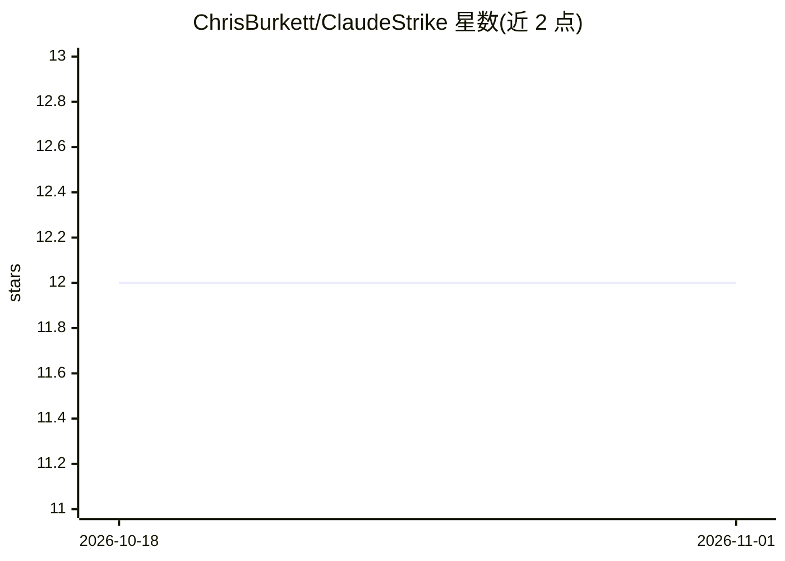

# ChrisBurkett/ClaudeStrike

⭐ 12 · Python · GPL-3.0 · 推送 2025-12-02 · [GitHub](https://github.com/ChrisBurkett/ClaudeStrike) · 个人维护

**给 Kali Linux 渗透测试人员的 Claude 终端助手**

面向 Kali Linux（或 Debian 系）命令行的 AI 渗透测试助手，通过 Anthropic API 接入 Claude，结合 MCP 集成执行命令，在终端内完成命令编写、工具运行与上下文维护。提供成本优化模式（prompt caching）、全功能模式与调试模式，并带终端 UI。安装方式为 curl 脚本或手动 git clone 后运行 install.sh，需 Python 3.8+ 与 Anthropic API key。以 MIT 许可发布。

## 筛选速览

| 维度 | 判定 | 备注 |
|---|---|---|
| AI 角色 | `ai-native` | 本体是模型或模型工具 |
| 许可风险 | `viral` | GPL-3.0 |
| 部署形态 | `None` |  |
| 模型依赖 | locked-api |  |
| 硬件要求 | — | 无带数字的原话,不猜 |
| 安装摩擦 | `low` | 无编译、无系统依赖或容器化 |
| 成熟度 | — | 结构信号不足 |

## 能力要点

- 通过 Anthropic API 在 Kali 终端内运行 Claude
- MCP 集成用于命令执行
- 成本优化模式（prompt caching）与全功能模式
- 提供 curl 一键安装与手动安装两条路径

## 适用场景

- 在 Kali 终端中获得 AI 协助编写与执行渗透测试命令
- 红队/蓝队操作中在无 GUI 环境下使用 AI 助手
- 控制 API 成本的日常安全操作

## 场景标签

`网络安全` · 领域:学习与行业

## 证据(README 行号)

> L3: AI-Powered Pentesting Assistant with MCP Integration for Kali Linux
> L9: - 🤖 AI-assisted penetration testing with Claude

## 星数曲线

2026-10-18 12 → 2026-11-01 12（+0）

---
*卡片 v1 · prompt 1.4 · 生成 2026-11-01 · 置信度 high · 依据 README sha `3e7e83c2d35e` · [字段定义](../../DATASET.md)*
