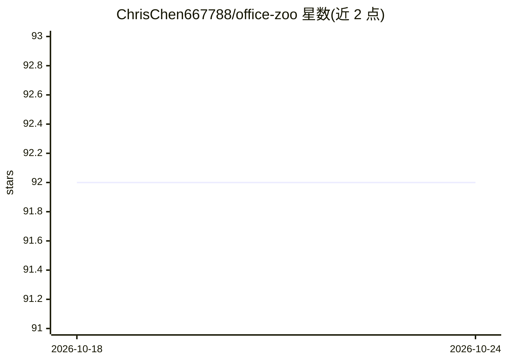

# ChrisChen667788/office-zoo

⭐ 92 · TypeScript · MIT · 推送 2026-10-08 · [GitHub](https://github.com/ChrisChen667788/office-zoo) · [官网](https://github.com/ChrisChen667788/office-zoo) · 个人维护 · 中文 README

**AI 自演职场狼人杀剧场：9 个 AI 鼠人替打工人上演办公室众生相**

面向打工人的娱乐向 Web 应用：9 个具备独立人格与记忆的 AI 鼠人在 2.5D 写字楼里自演职场狼人杀，观众可旁观、占席位发言投票、下注干预剧情。技术栈 React+Hono+Socket.IO，多智能体架构每鼠人独立 prompt，接入 MiniMax TTS（speech-2.8-hd）/文本（MiniMax-M2）/立绘生成（image-01），全项目以 OpenAI 兼容协议接入可切换后端，含多层降级（无 key 也能跑，Web Speech 兜底）。含 5 关劳动法闯关、公司主题包分享、段子 UGC、四语 i18n。MIT 开源，git clone+npm 运行。

## 筛选速览

| 维度 | 判定 | 备注 |
|---|---|---|
| AI 角色 | `ai-native` | 本体是模型或模型工具 |
| 许可风险 | `permissive` | MIT |
| 部署形态 | `library` | 以包/库形式分发 |
| 模型依赖 | — | README 未给出锁定关系 |
| 硬件要求 | — | 无带数字的原话,不猜 |
| 安装摩擦 | `low` | 无编译、无系统依赖或容器化 |
| 成熟度 | — | 结构信号不足 |

## 能力要点

- 9 个 AI 鼠人独立人格+记忆+prompt patch 的多智能体自演
- 4 种模式：看戏/沉浸 TTS/劳动法 5 关闯关/深夜酒馆 1v1
- 真人可占鼠人席位发言投票，AI 代打兜底
- 以 OpenAI 兼容协议接入，三层 LLM/四层 TTS 多层降级，无 key 可跑

## 适用场景

- 通勤路上看 AI 鼠人演职场众生相解压
- 跟 AI 鼠人 1v1 吐槽班味、喝酒聊天
- 通过裁了么闯关学习《劳动合同法》条文
- 自定义公司主题包，同事点链接进同一局

## 场景标签

`多智能体` · 领域:Agent 开发

## 证据(README 行号)

> L21: |**核心体验**|9 个有 personality 的 AI 鼠人在写字楼里自演职场众生相, 你 0 操作就看戏|
> L291: - MiniMax — `speech-2.8-hd` 真人 TTS / `MiniMax-M2` 文本 / `image-01` 立绘

## 星数曲线

2026-10-18 92 → 2026-10-24 92（+0）

---
*卡片 v1 · prompt 1.4 · 生成 2026-10-23 · 置信度 mid · 依据 README sha `4413c38dd631` · [字段定义](../../DATASET.md)*
