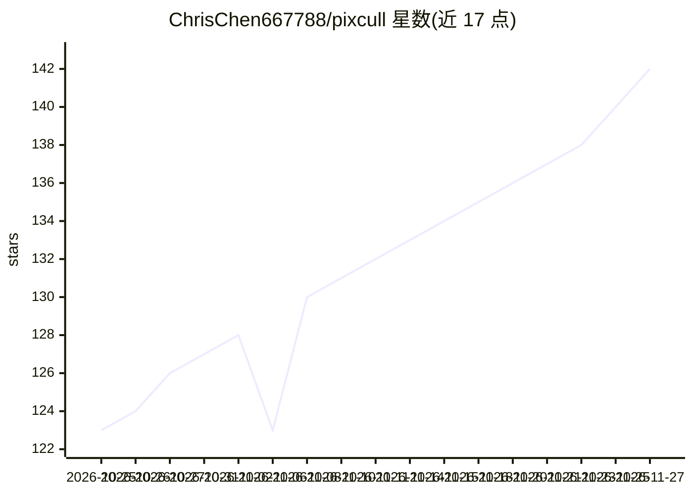

# ChrisChen667788/pixcull

⭐ 142 · Python · MIT · 推送 2026-11-25 · [GitHub](https://github.com/ChrisChen667788/pixcull) · [官网](https://github.com/ChrisChen667788/pixcull) · 个人维护 · 中文 README

**本地运行的 AI 照片选片工具，为摄影师提供六轴评分与理由**

面向职业摄影师的照片选片（culling）工具：将一次拍摄分为 keep/maybe/cull，对每帧在技术、主体、构图、光线、瞬间、美学六个轴上打 1–5 星并生成可读理由与出处引用。RAW 解码、评分、人脸聚类、GPS 聚类全部在本机运行，可选的 DeepSeek 元评审使用用户自己的 API token。结果以 XMP sidecar 输出供 Lightroom 与 Capture One 读取，另含 IPTC 说明、HTML 画廊、Lightroom 插件、iOS 配套应用、活动学习队列与多机同步。以 Python 包形式提供（pip install pixcull）。

## 筛选速览

| 维度 | 判定 | 备注 |
|---|---|---|
| AI 角色 | `ai-native` | 本体是模型或模型工具 |
| 许可风险 | `permissive` | MIT |
| 部署形态 | `library` | 以包/库形式分发 |
| 模型依赖 | — | README 未给出锁定关系 |
| 硬件要求 | — | 无带数字的原话,不猜 |
| 安装摩擦 | `medium` | 含编译或系统依赖之一 |
| 成熟度 | — | 结构信号不足 |

## 能力要点

- 六轴评分规则（技术/主体/构图/光线/瞬间/美学）并给出每轴理由
- 本地人脸聚类（InsightFace ArcFace 嵌入 + DBSCAN）与 GPS 位置聚类
- XMP sidecar 导出，Lightroom 与 Capture One 原生读取；含 tether 实时评审模式
- 10 种题材垂直分类调整保留阈值；支持突发连拍峰值排序与视频选片

## 适用场景

- 婚礼摄影师在不上传客户照片的前提下批量筛选上千张照片
- 需要向客户解释选片决策并获得评分理由的商业拍摄流程
- 连拍素材自动挑选峰值帧，同时保留连拍序列
- 将选片结果以 XMP 直接接入 Lightroom / Capture One 工作流

## 场景标签

`人脸识别` · 领域:感知与多模态

## 证据(README 行号)

> L28:  PixCull sorts a shoot into keep, maybe and cull, scores every frame on six
> L70: - **Local-first.** RAW decode, scoring, faces, GPS — everything runs

## 星数曲线

2026-10-25 123 → 2026-11-27 142（+19）

---
*卡片 v1 · prompt 1.4 · 生成 2026-11-27 · 置信度 high · 依据 README sha `b1e92bf0b966` · [字段定义](../../DATASET.md)*
