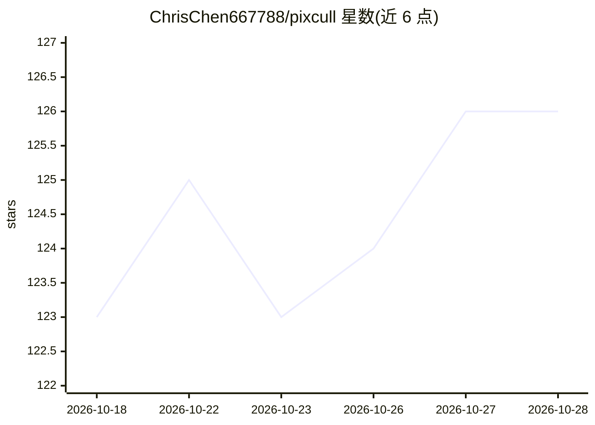

# ChrisChen667788/pixcull

⭐ 126 · Python · MIT · 推送 2026-10-28 · [GitHub](https://github.com/ChrisChen667788/pixcull) · [官网](https://github.com/ChrisChen667788/pixcull) · 个人维护 · 中文 README

**本地优先的 AI 照片筛选工具：六轴打分并写 XMP 给摄影师**

面向职业摄影师的本地照片筛选（culling）工具：将整场拍摄分为保留/待定/淘汰，对每帧按技术、主体、构图、光线、瞬间、美学六轴打 1-5 星并给出理由说明。RAW 解码、打分、人脸聚类（InsightFace ArcFace+DBSCAN）、GPS 聚类均在本地运行，照片不出磁盘；判定以 XMP/IPTC sidecar 导出，Lightroom 与 Capture One 可直接读取，并支持联机拍摄实时判定、iOS 配套 App（需自源码构建）与视频筛选/转录剪辑。可选 DeepSeek 元评判用用户自己的 API token。以 Python 包经 PyPI 提供，MIT 许可。

## 筛选速览

| 维度 | 判定 | 备注 |
|---|---|---|
| AI 角色 | `ai-native` | 本体是模型或模型工具 |
| 许可风险 | `permissive` | MIT |
| 部署形态 | `library` | 以包/库形式分发 |
| 模型依赖 | locked-api |  |
| 硬件要求 | — | 无带数字的原话,不猜 |
| 安装摩擦 | `medium` | 含编译或系统依赖之一 |
| 成熟度 | — | 结构信号不足 |

## 能力要点

- 六轴评分，每轴附理由与经典摄影理论引证
- 本地人脸聚类与跨场次人脸库、GPS 位置聚类
- XMP/IPTC sidecar 导出，Lightroom/Capture One 原生识别，含 Lr 插件与联机模式
- 9 种题材垂直档位、主动学习队列与淘汰原因分类

## 适用场景

- 婚礼/活动摄影师隔夜分拣上千张照片并向客户解释选片理由
- 受 NDA 或 embargo 约束不能上传云端的新闻摄影场景
- 野生动物连拍场景自动选出峰值帧并保留过程帧
- 通过 iOS 手机滑动配合笔记本完成快速分拣

## 场景标签

`图像视频处理` · 领域:感知与多模态

## 证据(README 行号)

> L28:  PixCull sorts a shoot into keep, maybe and cull, scores every frame on six
> L70: - **Local-first.** RAW decode, scoring, faces, GPS — everything runs

## 星数曲线

2026-10-18 123 → 2026-10-28 126（+3）

---
*卡片 v1 · prompt 1.4 · 生成 2026-10-23 · 置信度 high · 依据 README sha `82b112cfa730` · [字段定义](../../DATASET.md)*
