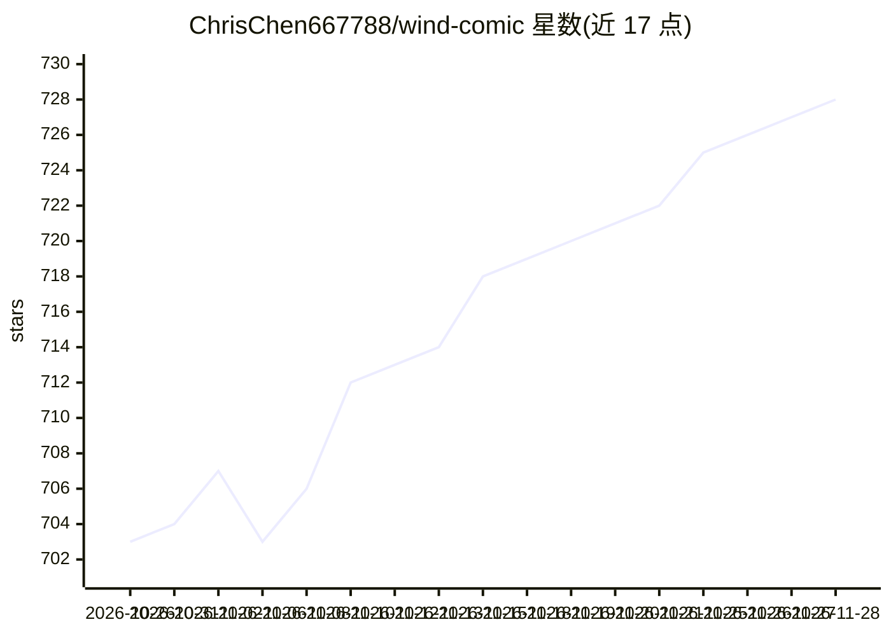

# ChrisChen667788/wind-comic

⭐ 728 · TypeScript · MIT · 推送 2026-11-27 · [GitHub](https://github.com/ChrisChen667788/wind-comic) · [官网](https://github.com/ChrisChen667788/wind-comic) · 个人维护 · 中文 README

**一句话生成完整短剧（剧本·分镜·配音·mp4）的多 Agent 工作室**

基于 Next.js 的多 Agent AI 创作流水线：输入一句话，经 Writer、Director、Storyboard 等 8 个角色 Agent 依次产出剧本、角色设定、分镜、配音、BGM、口型同步与最终 mp4。LLM 网关支持自带密钥并在多个模型间回退；12+ 媒体引擎经统一路由接入，生成时多引擎竞速取首个合格片段；视频打分低于 70 自动重生成（Vision-Audit 循环）。提供导演控片台、逐帧检查与片段重拍、实时多人时间线协作，数据持久化于 SQLite/PostgreSQL 双驱动。

## 筛选速览

| 维度 | 判定 | 备注 |
|---|---|---|
| AI 角色 | `ai-native` | 本体是模型或模型工具 |
| 许可风险 | `permissive` | MIT |
| 部署形态 | `self-host` | docker 或自建部署 |
| 模型依赖 | local-ok | 支持本地模型 |
| 硬件要求 | — | 无带数字的原话,不猜 |
| 安装摩擦 | `low` | 无编译、无系统依赖或容器化 |
| 成熟度 | — | 结构信号不足 |

## 能力要点

- 8 角色 Agent 流水线，阶段产物独立持久化并可单独重跑
- LLM 网关多模型回退，12+ 媒体引擎统一路由与多引擎竞速
- 导演控片台：几何推导景别/机位，生成前做构图确定性审计
- 逐帧检查→片段重拍闭环，只重生成损坏区段并保留版本回滚

## 适用场景

- 把一句话创意直接产出成带配音与 BGM 的成片短剧
- 长篇小说自动分集改编为系列短剧
- 团队通过实时时间线协作剪辑与重拍个别镜头
- 指定演员站位与摄像机位后按精确调度指令生成画面

## 场景标签

`多智能体` `视频生成` `AI 写作` · 领域:Agent 开发

## 证据(README 行号)

> L5:  One sentence in. A finished short-form drama out — script, cast, storyboards, voiceover, timeline, mp4.
> L40: It works because it doesn't try to be one giant model. It's an **honest multi-agent pipeline** where each role (Wri
> L55:  **System architecture** — five layers, top to bottom. The **Director** threads control across the seven pipeline a

## 星数曲线

2026-10-26 703 → 2026-11-28 728（+25）

---
*卡片 v1 · prompt 1.4 · 生成 2026-11-24 · 置信度 high · 依据 README sha `c6d4f4135c91` · [字段定义](../../DATASET.md)*
