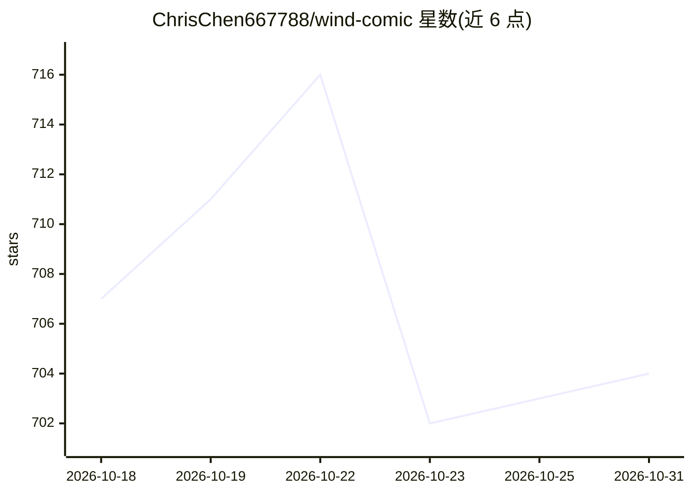

# ChrisChen667788/wind-comic

⭐ 704 · TypeScript · MIT · 推送 2026-10-30 · [GitHub](https://github.com/ChrisChen667788/wind-comic) · [官网](https://github.com/ChrisChen667788/wind-comic) · 个人维护 · 中文 README

**一句话文本生成完整短剧的多 Agent AI 工作室**

面向短剧创作者的多 Agent 流水线应用：输入一句话，经 Writer、Director、Character Designer、Storyboard Artist 等 8 个角色协作，产出剧本、角色设定、分镜、配音、时间线与最终 mp4。支持可复用角色、长篇小说自动分集、导演级控片台（演员/镜头调度、构图草图）、实时多人协作时间线与逐帧检查+分段重拍。LLM 网关在 DeepSeek→MiniMax 间自动回退，12+ 媒体引擎（Midjourney/Seedance/Kling/Veo/Vidu/fal/ComfyUI 等）经统一路由接入，双驱动存储（SQLite⇄PostgreSQL）。以 Next.js 16 / Node 20+ 项目形式提供。

## 筛选速览

| 维度 | 判定 | 备注 |
|---|---|---|
| AI 角色 | `ai-native` | 本体是模型或模型工具 |
| 许可风险 | `permissive` | MIT |
| 部署形态 | `self-host` | docker 或自建部署 |
| 模型依赖 | local-ok | 支持本地模型 |
| 硬件要求 | — | 无带数字的原话,不猜 |
| 安装摩擦 | `low` | 无编译、无系统依赖或容器化 |
| 成熟度 | — | 结构信号不足 |

## 能力要点

- 8 角色多 Agent 流水线：剧本→分镜→视频→剪辑产出完整短剧 mp4
- 导演级控片台：演员/镜头调度生成 prompt 指令与布局草图，镜头语言由几何推导
- Vision-Audit 重试循环与多引擎竞速（Seedance/Kling/Veo/Vidu 先到先用）
- 逐帧检查与分段重拍：只重生成指定秒数，其余帧视觉无损重编码

## 适用场景

- 把一句话创意变成带配音和 BGM 的完整短剧
- 将长篇小说自动分集并保持角色一致性
- 团队在实时协作时间线上共同剪辑成片

## 场景标签

`多智能体` `视频生成` `图像生成` · 领域:Agent 开发

## 证据(README 行号)

> L5:  One sentence in. A finished short-form drama out — script, cast, storyboards, voiceover, timeline, mp4.
> L33: It works because it doesn't try to be one giant model. It's an **honest multi-agent pipeline** where each role (Wri

## 星数曲线

2026-10-18 707 → 2026-10-31 704（-3）

---
*卡片 v1 · prompt 1.4 · 生成 2026-10-21 · 置信度 low · 依据 README sha `62baf023ba29` · [字段定义](../../DATASET.md)*
