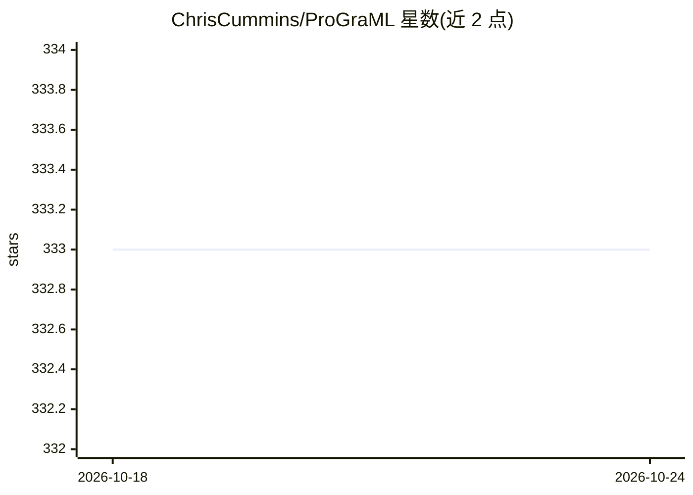

# ChrisCummins/ProGraML

⭐ 333 · C++ · NOASSERTION · 推送 2026-10-01 · [GitHub](https://github.com/ChrisCummins/ProGraML) · 个人维护

**将程序表示为图供机器学习模型使用的 Python 库**

ProGraML 提供语言无关的程序图表示，把 C、C++、LLVM-IR（3.8/6.0/10.0）与 XLA HLO 程序转换为捕获控制流、数据流与调用关系的图，支持 NetworkX、DGL、Graphviz、JSON 等图格式输出，特征与标签可在任意粒度添加。核心图构造以 C++ 实现并通过 pip 安装、无需编译，API 方法支持 executor 参数并行。面向做程序分析、编译器优化研究的机器学习研究者，附 ICML 2021 论文与在线程序图浏览器。

## 筛选速览

| 维度 | 判定 | 备注 |
|---|---|---|
| AI 角色 | `ai-ecosystem` | LLM/agent 周边工具 |
| 许可风险 | `none` | NOASSERTION |
| 部署形态 | `library` | 以包/库形式分发 |
| 模型依赖 | — | README 未给出锁定关系 |
| 硬件要求 | — | 无带数字的原话,不猜 |
| 安装摩擦 | `low` | 无编译、无系统依赖或容器化 |
| 成熟度 | — | 结构信号不足 |

## 能力要点

- 支持 C/C++/LLVM-IR/XLA 四类语言与 IR 的图表示
- 捕获全程序的控制、数据与调用关系，语言无关
- C++ 实现核心，pip 安装无需编译，支持 executor 并行
- 输出 NetworkX/DGL/Graphviz/JSON 多种图格式

## 适用场景

- 为机器学习模型准备程序图输入做数据流分析
- 在编译器优化任务上做全程序或指令级推理
- 在线浏览程序图表示以理解其结构

## 场景标签

`科研工具` · 领域:学习与行业

## 证据(README 行号)

> L34: ProGraML is a representation for programs as input to a machine learning model.
> L37: 1. **Simple:** Everything is available through a `pip install`, no compilation

## 星数曲线

2026-10-18 333 → 2026-10-24 333（+0）

---
*卡片 v1 · prompt 1.4 · 生成 2026-10-21 · 置信度 high · 依据 README sha `771c0ac66246` · [字段定义](../../DATASET.md)*
