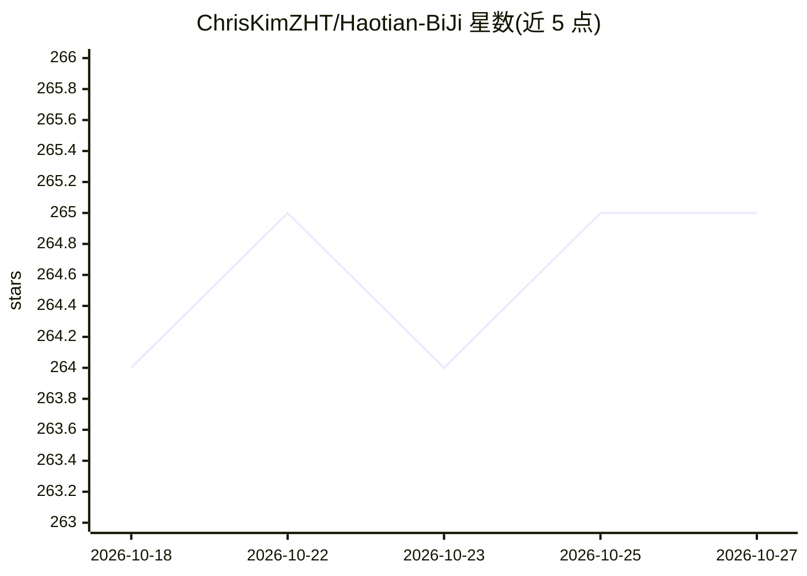

# ChrisKimZHT/Haotian-BiJi

⭐ 265 · CC-BY-SA-4.0 · 推送 2026-10-23 · [GitHub](https://github.com/ChrisKimZHT/Haotian-BiJi) · [官网](https://io.zouht.com) · 个人维护 · 中文 README

**个人博客的算法与机器学习学习笔记源文件库**

存储「颢天笔记」网站的 Markdown 原文件，内容以 ACM 竞赛算法、数据结构、题解为主，2024 年起向机器学习内容转型。文件按页面 ID、分类（算法、数据结构、机器学习、数论、题目、杂项）、标题命名。公式以 LaTeX 编写，GitHub 网页可部分渲染，完整浏览需访问作者网站或本地 Markdown 编辑器；图片托管在博客 CDN 并开启反盗链，转载需手动下载替换。采用 CC BY-SA 4.0 许可。

## 筛选速览

| 维度 | 判定 | 备注 |
|---|---|---|
| AI 角色 | `ai-knowledge` | 知识聚合/清单类 |
| 许可风险 | `viral` | CC-BY-SA-4.0 |
| 部署形态 | `None` |  |
| 模型依赖 | — | README 未给出锁定关系 |
| 硬件要求 | — | 无带数字的原话,不猜 |
| 安装摩擦 | `low` | 无编译、无系统依赖或容器化 |
| 成熟度 | — | 结构信号不足 |

## 能力要点

- ACM 竞赛算法、数据结构与题目题解的 Markdown 笔记
- 2024 年起新增机器学习分类内容
- 统一命名规则：页面 ID+分类+标题
- CC BY-SA 4.0 许可，可署名转载

## 适用场景

- 查找 ACM 竞赛算法与数据结构的学习资料
- 参考竞赛题目的题解
- 浏览作者的机器学习学习笔记

## 场景标签

`教程课程` · 领域:学习与行业

## 证据(README 行号)

> L3: 颢天笔记 网站的 Markdown 源文件，内容大多为 ACM 竞赛算法与竞赛题目题解，从 2024 年开始向机器学习内容转型。
> L10: - `Category` - 对应文章的分类目录，目前有算法、数据结构、机器学习、数论、题目、杂项。

## 星数曲线

2026-10-18 264 → 2026-10-27 265（+1）

---
*卡片 v1 · prompt 1.4 · 生成 2026-10-22 · 置信度 high · 依据 README sha `9e362cfa1265` · [字段定义](../../DATASET.md)*
