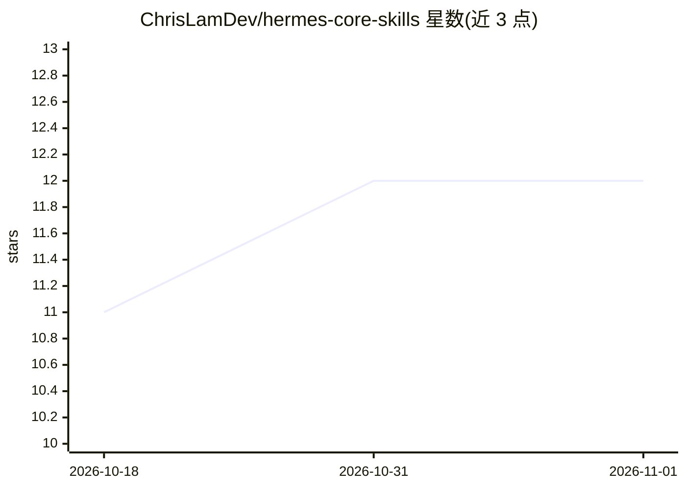

# ChrisLamDev/hermes-core-skills

⭐ 12 · Python · MIT · 推送 2026-07-01 · [GitHub](https://github.com/ChrisLamDev/hermes-core-skills) · [官网](https://chrislamdev.github.io/hermes-core-skills/) · 个人维护 · 中文 README

**给 AI 编码代理的 25 个可执行工作流技能包**

以 Markdown 技能文件形式提供 26 个（README 亦称 25 个，数字前后不一致）可执行工作流，覆盖系统化调试、计划先行、token 效率、自调节刹车、检查点回滚与安全加固等，分为 Agent Core、生态系统、跨会话规划、集成四类。安装方式为 cp 命令复制到 Claude Code、Cursor、OpenAI Codex CLI 的 skills 目录或 Hermes Agent 自动分发目录，随后在对话中指名技能触发。以 MIT 许可发布，README 提供英文版并招募翻译。

## 筛选速览

| 维度 | 判定 | 备注 |
|---|---|---|
| AI 角色 | `ai-ecosystem` | LLM/agent 周边工具 |
| 许可风险 | `permissive` | MIT |
| 部署形态 | `None` |  |
| 模型依赖 | — | README 未给出锁定关系 |
| 硬件要求 | — | 无带数字的原话,不猜 |
| 安装摩擦 | `low` | 无编译、无系统依赖或容器化 |
| 成熟度 | — | 结构信号不足 |

## 能力要点

- 25/26 个技能按 4 大类组织，含调试、规划、token 效率、安全清单
- 一条 cp 命令安装到 Claude Code / Cursor / Codex / Hermes Agent
- 自调节刹车（3 次失败强制停止）与检查点回滚机制
- 兼容 MCP 客户端与 LangChain / CrewAI / AutoGen 等框架

## 适用场景

- 让编码代理按固定工作流调试而不是随机修补
- 控制代理的 token 消耗与上下文使用
- 在代码修改前自动备份并要求计划审批

## 场景标签

`提示工程` · 领域:Agent 开发

## 证据(README 行号)

> L22: **This pack of 26 executable skills fixes all of that.** Not vague advice. Step-by-step workflows your agent loads 
> L57: These 25 skills are executable workflows that teach your agent **how to behave** — systematic debugging, token-awar
> L70: Hermes Core Skills is not a framework you integrate — it's a **workflow layer** your agent loads. It works alongsid

## 星数曲线

2026-10-18 11 → 2026-11-01 12（+1）

---
*卡片 v1 · prompt 1.4 · 生成 2026-11-01 · 置信度 high · 依据 README sha `72646e222653` · [字段定义](../../DATASET.md)*
