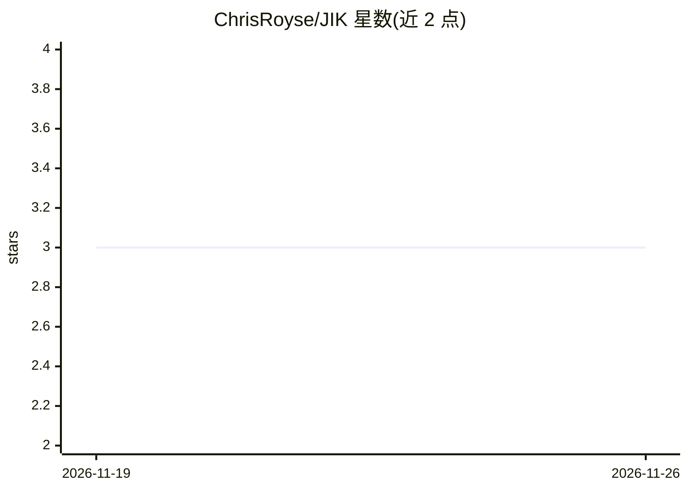

# ChrisRoyse/JIK

⭐ 3 · Python · 推送 2026-11-21 · [GitHub](https://github.com/ChrisRoyse/JIK) · 个人维护

**从零训练的“意义原生”语言模型研究项目，预测下一含义而非下一 token**

JIK 是一个从零训练的语言模型研究项目，不使用任何预训练生成式 LLM。文本被切分为原子，由多个冻结、哈希固定的嵌入器（称为 instrument，含 MPNet、CodeBERT、E5、FinBERT、PubMedBERT、SPECTER2）各自测量，模型在类型化测量之上学习关联图与区域预测，输出前用同一组仪器复检，未通过则拒绝作答而非猜测。当前语料为俄亥俄州法律记录，现有可检验结果是预测法庭意见中下一引用文献的任务；README 明确声明这是研究预览，尚不能产出有用的完整自由文本回答。

## 筛选速览

| 维度 | 判定 | 备注 |
|---|---|---|
| AI 角色 | `ai-native` | 本体是模型或模型工具 |
| 许可风险 | `none` | — |
| 部署形态 | `None` |  |
| 模型依赖 | — | README 未给出锁定关系 |
| 硬件要求 | — | 无带数字的原话,不猜 |
| 安装摩擦 | `low` | 无编译、无系统依赖或容器化 |
| 成熟度 | `idea` | |

## 能力要点

- 多仪器并行测量文本原子，槽位不混合、不拼接
- 输出经同组仪器复检，未通过则输出带错误码的拒绝
- 当前测试任务为预测下一引用文献，报告 49,978 事件上的对比数据
- 要求 Full State Verification：从持久化字节冷重放并独立回读

## 适用场景

- 研究语言模型的非 token 化学习接口
- 法律语料上的下一引用文献预测实验
- 参考其拒绝门与可复现性校验流程

## 场景标签

`科研工具` `模型训练` · 领域:学习与行业

## 证据(README 行号)

> L3:  A language model that predicts the next meaning , not the next token.
> L14: **JIK** (Jesus Is King) is a from-scratch *meaning-native language model* (MNLM) and the
> L83: The model reads a request and its context as constellations, then builds its answer one atom

## 星数曲线

2026-11-19 3 → 2026-11-26 3（+0）

---
*卡片 v1 · prompt 1.4 · 生成 2026-11-22 · 置信度 high · 依据 README sha `be8bb5d49f4d` · [字段定义](../../DATASET.md)*
