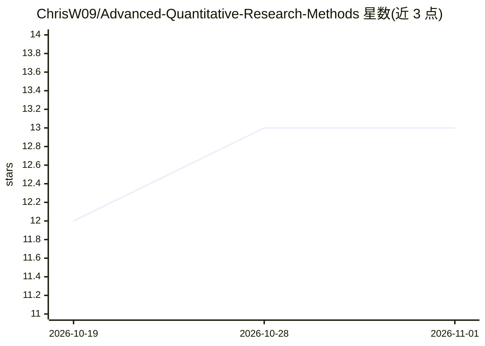

# ChrisW09/Advanced-Quantitative-Research-Methods

⭐ 13 · Jupyter Notebook · 推送 2026-10-19 · [GitHub](https://github.com/ChrisW09/Advanced-Quantitative-Research-Methods) · [官网](https://chrisw09.github.io/Advanced-Quantitative-Research-Methods/) · 组织维护

**基于 ISLP 教材的可直接授课的统计学习大学课程材料**

一套完整的大学统计学习课程讲义：10 个 LaTeX Beamer 幻灯片组（901 页核心+199 页附录）、10 个 Jupyter 实验笔记本、109 道带完整解答的习题、3+5 份模拟考试与 23 个数据集，内容结构沿用 ISLP（Springer 2023）教材章节。幻灯片 PDF 可直接阅读无需工具链，笔记本可一键在 Google Colab 打开并自动装载数据，也可用 pip 在本地虚拟环境运行（约 150 个包，ISLP 硬依赖 torch）。附教师指南：11 次课学期计划、分课时运行单与 make 命令同步。由 Prof. Dr. Christoph Weisser 编写。

## 筛选速览

| 维度 | 判定 | 备注 |
|---|---|---|
| AI 角色 | `ai-knowledge` | 知识聚合/清单类 |
| 许可风险 | `none` | — |
| 部署形态 | `library` | 以包/库形式分发 |
| 模型依赖 | — | README 未给出锁定关系 |
| 硬件要求 | — | 无带数字的原话,不猜 |
| 安装摩擦 | `medium` | 含编译或系统依赖之一 |
| 成熟度 | — | 结构信号不足 |

## 能力要点

- 901 页核心幻灯片+199 页附录，10 个实验笔记本均可在 Colab 一键运行
- 109 道习题均带完整解答，按 Concept/Math/Python/Integrative 标签分类
- 23 个数据集经 ISLP 包自动解析，离线时回退到内置 CSV 文件夹
- 提供 11 次课的教学指南、运行单与同步用 make 命令

## 适用场景

- 直接开设一门 6 ECTS 的统计学习大学课程
- 学生按幻灯片+笔记本自学 ISLP 各章内容
- 用模拟考试与带解答的习题备考和练习

## 场景标签

`教程课程` · 领域:学习与行业

## 证据(README 行号)

> L3:  A complete, ready-to-teach university course in statistical learning —
> L20: > **These materials are based on the textbook** *An Introduction to Statistical

## 星数曲线

2026-10-19 12 → 2026-11-01 13（+1）

---
*卡片 v1 · prompt 1.4 · 生成 2026-10-31 · 置信度 high · 依据 README sha `56c9107781d5` · [字段定义](../../DATASET.md)*
