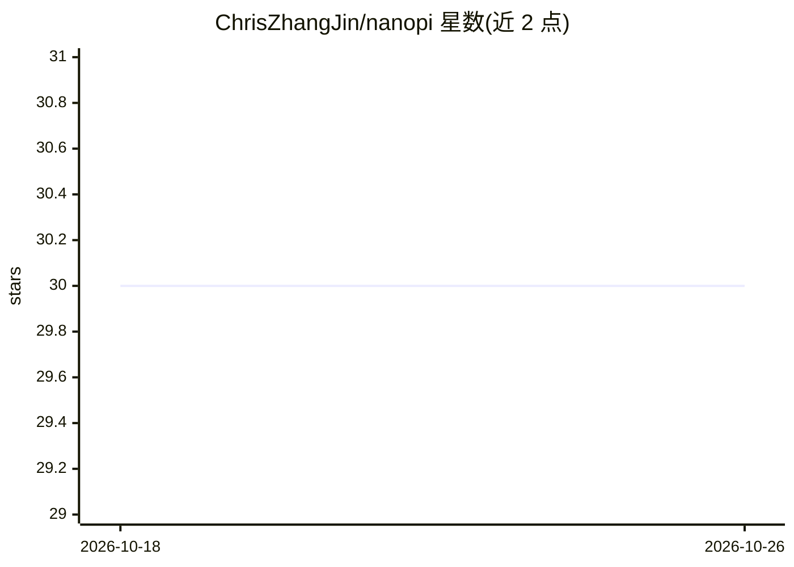

# ChrisZhangJin/nanopi

⭐ 30 · Rust · MIT · 推送 2026-10-08 · [GitHub](https://github.com/ChrisZhangJin/nanopi) · 个人维护 · 中文 README

**单文件约 4MB 静态 Rust 编码 agent CLI，适配老旧低资源 Linux**

从 Pi 移植的 Rust 编码 agent 命令行工具，编译为约 4MB 的静态 musl 单二进制，可在 Alpine、CentOS 6（glibc 2.12+）等无 Node/Python 运行时的旧机器上运行。支持任意 OpenAI 兼容端点（DeepSeek、ollama、vLLM 等）与原生 Anthropic 协议，提供流式工具调用（read/write/edit/bash）、ratatui TUI、JSONL 会话、Agent Skills、Claude Code 协议 hooks、WASM 插件与 -p 非交互模式。提供六个平台预编译二进制，亦可从源码 cargo 构建。

## 筛选速览

| 维度 | 判定 | 备注 |
|---|---|---|
| AI 角色 | `ai-native` | 本体是模型或模型工具 |
| 许可风险 | `permissive` | MIT |
| 部署形态 | `desktop` | 安装包/桌面程序 |
| 模型依赖 | local-ok | 支持本地模型 |
| 硬件要求 | — | 无带数字的原话,不猜 |
| 安装摩擦 | `medium` | 含编译或系统依赖之一 |
| 成熟度 | — | 结构信号不足 |

## 能力要点

- 约 4MB 静态 musl 二进制，零运行时依赖，支持 glibc 2.12+ 旧系统
- 多 provider：任意 OpenAI 兼容端点 + 原生 Anthropic，可拆分 <think> 思考块
- 流式工具调用 read/write/edit/bash 与 ratatui TUI
- Agent Skills（SKILL.md）、Claude Code 协议 shell hooks 与 WASM 插件双扩展系统

## 适用场景

- 在没有 Node/Python 的老旧服务器或 Alpine 容器上跑编码 agent
- 通过 OpenAI 兼容端点接入 DeepSeek/ollama/vLLM 等模型做编码任务
- 在 Android Termux 环境使用编码 agent（android-aarch64 构建）
- 用 hooks 与 WASM 插件对工具调用做拦截与扩展

## 场景标签

`编码 Agent` · 领域:编码与开发

## 证据(README 行号)

> L5: A coding-agent CLI you can `scp` onto a box that has no runtime —
> L35: - 🔌 **Multi-provider** — any OpenAI-compatible endpoint (DeepSeek, ollama, vLLM, …) plus native Anthropic; `provide

## 星数曲线

2026-10-18 30 → 2026-10-26 30（+0）

---
*卡片 v1 · prompt 1.4 · 生成 2026-10-26 · 置信度 mid · 依据 README sha `2ab0b8ce82f1` · [字段定义](../../DATASET.md)*
