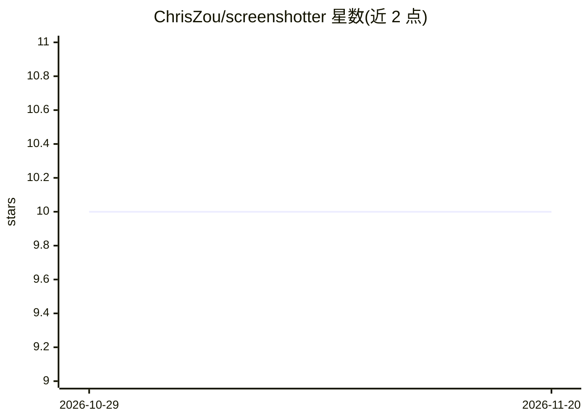

# ChrisZou/screenshotter

⭐ 10 · Swift · 推送 2026-03-02 · [GitHub](https://github.com/ChrisZou/screenshotter) · 个人维护 · 中文 README

**macOS 定时截屏并用 AI 视觉模型生成活动记录的工具**

面向 macOS 用户的自动截屏分析工具：客户端每隔可配置间隔（1s–60s）截取屏幕，调用 AI 视觉模型生成一句话活动描述，写入本地 SQLite 数据库；截图在分析完成 60 秒后删除，仅保留文字，锁屏时不截图。可选部署配套的 Go 服务器（提供 REST API）同步元数据。客户端需自行用 Swift 构建或运行，首次使用需授予屏幕录制权限并配置 AI 提供商的 API Key。

## 筛选速览

| 维度 | 判定 | 备注 |
|---|---|---|
| AI 角色 | `ai-native` | 本体是模型或模型工具 |
| 许可风险 | `none` | — |
| 部署形态 | `desktop` | 安装包/桌面程序 |
| 模型依赖 | — | README 未给出锁定关系 |
| 硬件要求 | — | 无带数字的原话,不猜 |
| 安装摩擦 | `low` | 无编译、无系统依赖或容器化 |
| 成熟度 | — | 结构信号不足 |

## 能力要点

- 定时截屏并调用 AI 视觉模型生成一句话活动描述
- 截图分析后 60 秒自动删除，仅保留文字与元数据
- 可选 Go 服务器（Docker Compose 部署）提供 REST API 同步与统计
- 截屏间隔、截图质量、开机自启动等设置项可配置

## 适用场景

- 记录自己每天在电脑上做了什么，生成时间线活动描述
- 自部署服务器集中保存多台设备的活动元数据
- 用 sqlite3 直接查询本地活动记录数据库

## 场景标签

`多模态` · 领域:感知与多模态

## 证据(README 行号)

> L3: 一个自动截屏 + AI 分析的 macOS 工具。每隔几秒截取屏幕，调用 AI 视觉模型生成一句话描述你正在做什么（如「在编写代码」「在浏览网页」），记录到本地数据库，可选同步到自部署的服务器。
> L8: 截屏 → AI 分析（Kimi / Seed 2.0 Lite） → 本地 SQLite 存储 → （可选）同步到服务器

## 星数曲线

2026-10-29 10 → 2026-11-20 10（+0）

---
*卡片 v1 · prompt 1.4 · 生成 2026-11-20 · 置信度 high · 依据 README sha `3083d2108ec8` · [字段定义](../../DATASET.md)*
