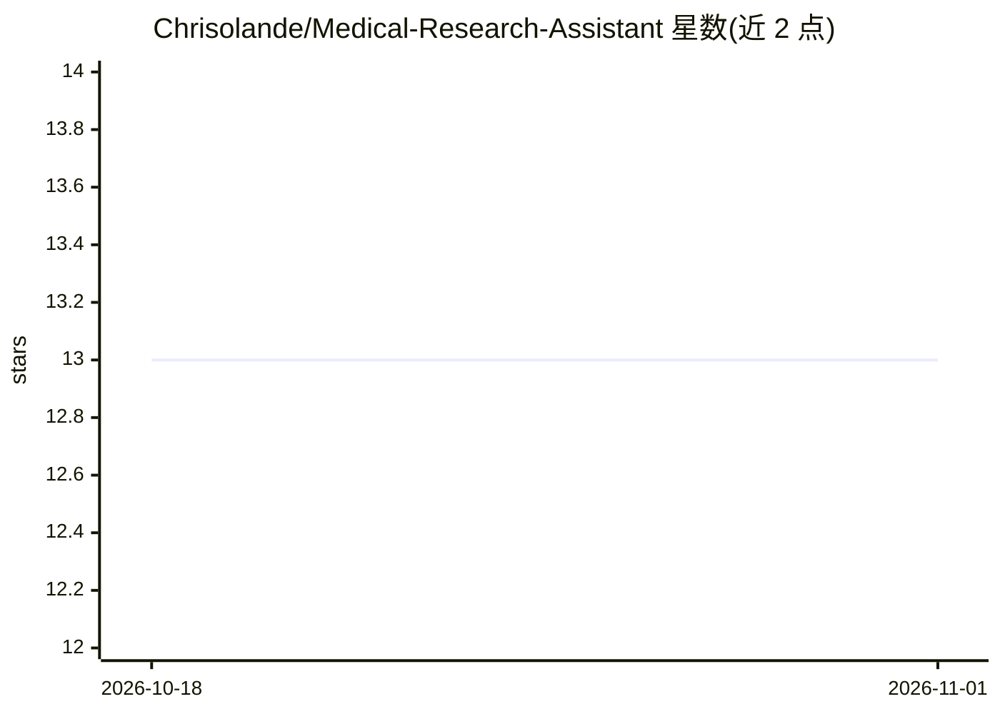

# Chrisolande/Medical-Research-Assistant

⭐ 13 · Python · MIT · 推送 2026-08-03 · [GitHub](https://github.com/Chrisolande/Medical-Research-Assistant) · 个人维护

**面向医学文献问答的 RAG 应用：知识图谱+向量检索+LLM 生成**

用 Streamlit 构建的医学研究问答应用：文档分块后经生物医学嵌入模型与 NER 建图（余弦相似度>0.8 且共享生物医学实体即连边），检索时 FAISS 召回并经交叉编码器重排，再以优先队列遍历知识图扩展上下文，DeepSeek 每遍历若干节点判断是否足以作答，最终生成回答。支持 PubMed 在线检索摄取、预置 FAISS 索引、三级语义缓存（内存/SQLite/FAISS）。需 Python 3.11+ 与 DeepSeek API key，PubMed 搜索另需 NCBI 邮箱。

## 筛选速览

| 维度 | 判定 | 备注 |
|---|---|---|
| AI 角色 | `ai-native` | 本体是模型或模型工具 |
| 许可风险 | `permissive` | MIT |
| 部署形态 | `library` | 以包/库形式分发 |
| 模型依赖 | locked-api |  |
| 硬件要求 | — | 无带数字的原话,不猜 |
| 安装摩擦 | `low` | 无编译、无系统依赖或容器化 |
| 成熟度 | — | 结构信号不足 |

## 能力要点

- 知识图谱+向量检索+优先队列遍历的 RAG 管线，LLM 充分性检查可提前停止
- 通过 NCBI Entrez API 在线检索 PubMed 并直接摄取摘要与 MeSH 词
- 三级语义响应缓存（内存/SQLite/FAISS）减少重复 LLM 调用
- 检索参数（重排、边阈值、遍历深度、缓存距离）可通过配置或 UI 调整

## 适用场景

- 我想直接用预置索引对医学文献提问
- 我想按主题抓取 PubMed 文献构建自己的医学知识库并问答
- 我想上传自有医学摘要 JSON 建立问答库

## 场景标签

`RAG` `科研工具` `文档问答` · 领域:知识与检索

## 证据(README 行号)

> L10: A RAG pipeline that combines a biomedical knowledge graph with vector search to answer medical research questions. 
> L26: 4. **Answer generation** - If early stopping triggers, the synthesised answer is returned directly. Otherwise, the 
> L89: streamlit run app.py

## 星数曲线

2026-10-18 13 → 2026-11-01 13（+0）

---
*卡片 v1 · prompt 1.4 · 生成 2026-10-31 · 置信度 high · 依据 README sha `85565009c131` · [字段定义](../../DATASET.md)*
