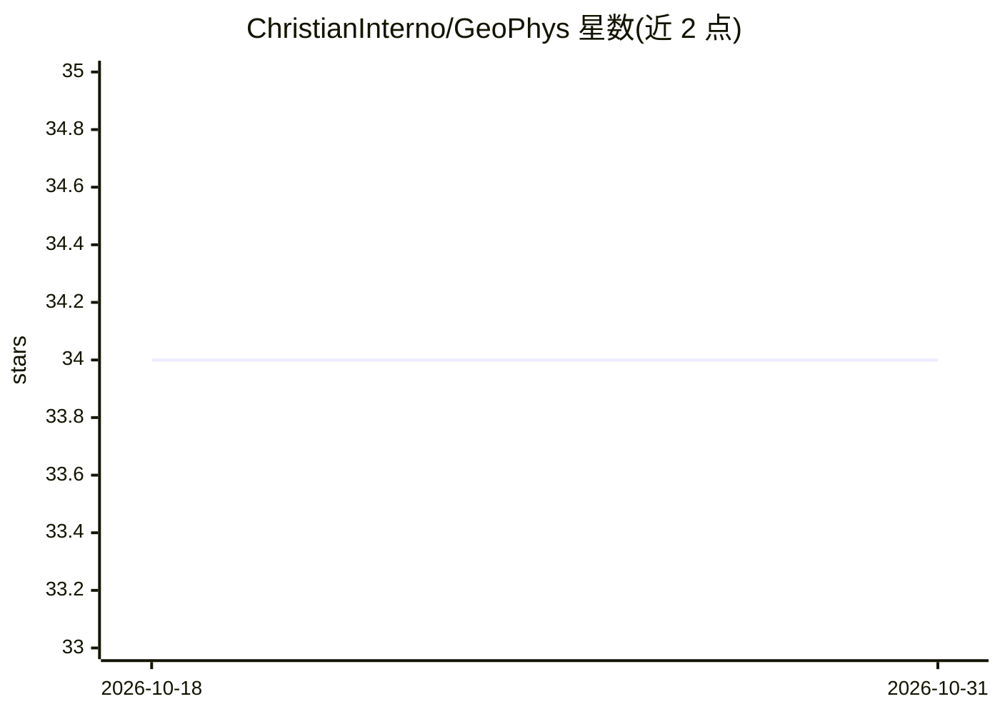

# ChristianInterno/GeoPhys

⭐ 34 · Python · MIT · 推送 2026-10-13 · [GitHub](https://github.com/ChristianInterno/GeoPhys) · [官网](https://christianinterno.github.io/GeoPhys/) · 个人维护

**免训练的视频物理合理性评分与检测库（NeurIPS 论文）**

GeoPhys 用冻结图像编码器（DINOv2/DINOv3/CORnet-S/VOneNet）把视频帧映射为表征空间轨迹，再用无学习参数的几何统计（曲率、速度变化、角度一致性、加速度、预测残差等）输出物理合理性分数。提供 Python API 与命令行工具：判断两视频中哪个违反物理、best-of-N 候选挑选、逐视频评分、用自己的标注对校准。需 Python 3.10、PyTorch 2.1+ 与 GPU 做特征提取；另发布 3,168 个生成视频与四个基准的特征数据。

## 筛选速览

| 维度 | 判定 | 备注 |
|---|---|---|
| AI 角色 | `ai-native` | 本体是模型或模型工具 |
| 许可风险 | `permissive` | MIT |
| 部署形态 | `library` | 以包/库形式分发 |
| 模型依赖 | — | README 未给出锁定关系 |
| 硬件要求 | — | 无带数字的原话,不猜 |
| 安装摩擦 | `low` | 无编译、无系统依赖或容器化 |
| 成熟度 | — | 结构信号不足 |

## 能力要点

- 无训练参数的轨迹几何统计评分，四个冻结视觉骨干
- 三个 API：rate（逐视频评分）/compare（违反判定）/pick（best-of-N 选择）
- 支持用自己的标注对做域内校准（geophys.calibrate）
- 发布 3,168 个 MAGI-1 生成视频及 Physics-IQ 分数、多层特征数据集

## 适用场景

- 给视频生成模型输出逐视频打物理合理性分并对比/过滤
- 推理时从 N 个生成候选中挑最物理合理的一个
- 研究冻结视觉表征的轨迹几何，无需 GPU（用已发布特征）

## 场景标签

`模型评测` · 领域:评测与运维

## 证据(README 行号)

> L19: A frozen image encoder maps each video frame to a feature; stacked across time, the video becomes a trajectory in r
> L21: The same score is applied unchanged across three settings: alignment with human EEG responses to object-permanence 
> L35: - **Rate the physical plausibility of your generated videos**, one score per video, to compare models or filter sam

## 星数曲线

2026-10-18 34 → 2026-10-31 34（+0）

---
*卡片 v1 · prompt 1.4 · 生成 2026-10-25 · 置信度 high · 依据 README sha `42132ee451c0` · [字段定义](../../DATASET.md)*
