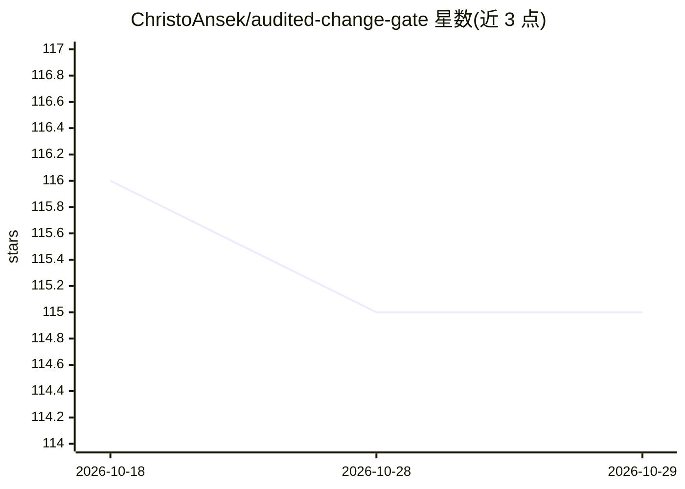

# ChristoAnsek/audited-change-gate

⭐ 115 · HTML · 推送 2026-10-28 · [GitHub](https://github.com/ChristoAnsek/audited-change-gate) · 个人维护

**自主 agent 基础设施变更的密码学审计门控（proof-carrying envelope）**

面向 AI agent 自动化变更的信任网关：每个变更请求封装为防篡改的信封，内含会话级 Ed25519 签名的身份令牌、资源作用域描述、前向操作哈希、预计算的回滚蓝图与有效期；网关验证签名、影响集（blast radius）与可回滚性后才放行，并写入仅追加的签名审计日志。提供 Strict/Audit-Only/Permissive 三种模式与 N-of-M 多方联签。以无依赖的静态链接二进制（<2MB）运行于 POSIX/Windows，提供 shell/Python/Go/C/Rust 绑定；README 仅有 Download 链接，未见具体安装命令或构建说明。

## 筛选速览

| 维度 | 判定 | 备注 |
|---|---|---|
| AI 角色 | `ai-ecosystem` | LLM/agent 周边工具 |
| 许可风险 | `none` | — |
| 部署形态 | `None` |  |
| 模型依赖 | — | README 未给出锁定关系 |
| 硬件要求 | — | 无带数字的原话,不猜 |
| 安装摩擦 | `low` | 无编译、无系统依赖或容器化 |
| 成熟度 | — | 结构信号不足 |

## 能力要点

- proof-carrying 信封：身份令牌+作用域+前向哈希+预计算回滚+有效期
- blast radius 影响集计算，命中保护资源即拒绝
- N-of-M 多方联签与单调序列号防重放
- 零依赖静态二进制（<2MB），append-only 签名审计日志

## 适用场景

- 在生产环境为 agent 的防火墙/Intune/K8s 变更加门控
- 多 agent CI/CD 管线中要求可验证回滚后批量变更
- 合规与审计要求下记录每次 agent 操作的签名收据

## 场景标签

 · 领域:AI 安全/运维工具

## 证据(README 行号)

> L5: **Certifier** is a language-agnostic, zero-trust envelope for verifying every action an autonomous agent takes—befor
> L11: Modern agentic systems can write code, reconfigure firewalls, push Intune policies, or adjust Kubernetes replicas—a
> L116: Certifier does not replace your existing change management tooling—it augments it. There are three primary integra

## 星数曲线

2026-10-18 116 → 2026-10-29 115（-1）

---
*卡片 v1 · prompt 1.4 · 生成 2026-10-23 · 置信度 mid · 依据 README sha `cd0685379d35` · [字段定义](../../DATASET.md)*
