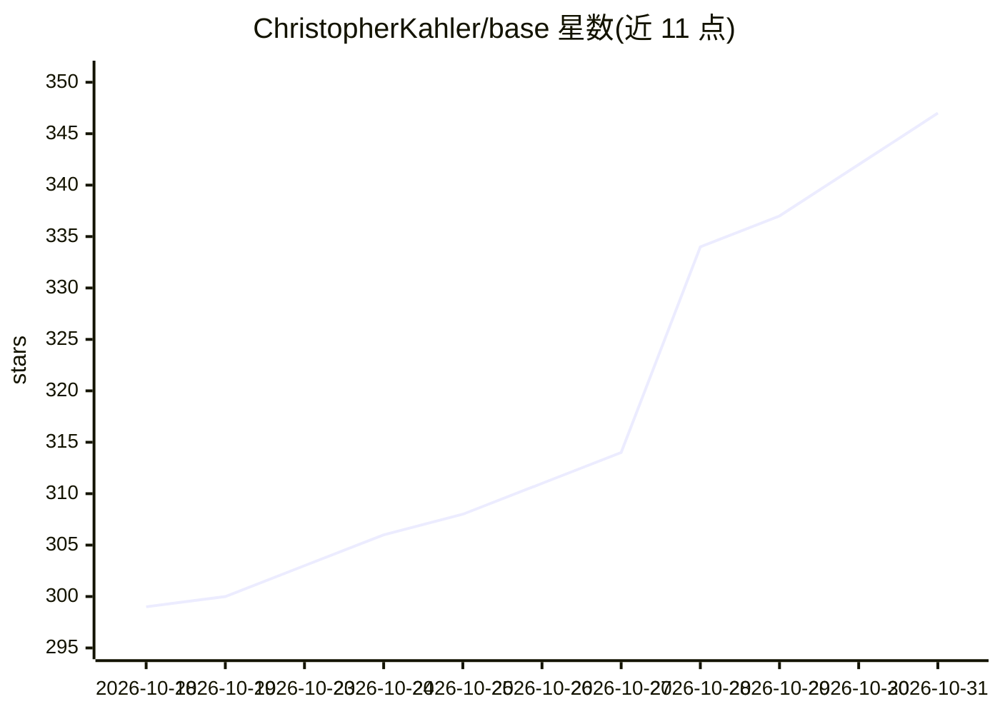

# ChristopherKahler/base

⭐ 347 · Rust · NOASSERTION · 推送 2026-10-06 · [GitHub](https://github.com/ChristopherKahler/base) · [官网](https://docs.basemode.ai) · 个人维护

**给 Claude Code 加持久记忆的 Rust 单二进制：工作区知识图谱+钩子注入**

一个约 20MB 的 Rust 单二进制 `base`，把工作区映射为知识图谱（tree-sitter 抽取 35+ 语言的代码结构、项目/决策/规则、Markdown 文档），存储为 git 内 NQuads 纯文本，通过嵌入 Oxigraph 支持 SPARQL 查询。它接入 Claude Code 的 hook 管线，在会话开始、提示时、工具运行前后四个时点注入相关上下文切片；提供会话交接（*handoff/*fork/*base/*end）、多会话 relay、自动更新与嵌入式 dashboard Web UI。面向使用 Claude Code 的开发者；Codex 与 Antigravity 适配标注 coming soon；需先安装 Claude Code 才能生效。

## 筛选速览

| 维度 | 判定 | 备注 |
|---|---|---|
| AI 角色 | `ai-ecosystem` | LLM/agent 周边工具 |
| 许可风险 | `none` | NOASSERTION |
| 部署形态 | `library` | 以包/库形式分发 |
| 模型依赖 | — | README 未给出锁定关系 |
| 硬件要求 | — | 无带数字的原话,不猜 |
| 安装摩擦 | `medium` | 含编译或系统依赖之一 |
| 成熟度 | — | 结构信号不足 |

## 能力要点

- tree-sitter 抽取 35+ 语言代码结构，SPARQL 可查询的知识图谱
- Claude Code hook 管线的四时点上下文注入
- 会话交接/分叉命令与本地多会话 relay 协调
- NQuads 纯文本存储于仓库内，可随 git diff；自动自更新

## 适用场景

- 让 Claude Code 会话之间保留代码结构、决策与规则记忆
- 打开文件前自动获得该文件的实体、导入与依赖方信息
- 多会话并行工作时通过 relay 交接任务

## 场景标签

`Agent 记忆` `知识图谱` · 领域:Agent 开发

## 证据(README 行号)

> L18: This repo is the basemode engine: one Rust binary, `base`, that maps your workspace into a knowledge graph and wire
> L30: basemode wires into every hook Claude Code exposes. Each injection is a query against the moment — opening an auth 

## 星数曲线

2026-10-18 299 → 2026-10-31 347（+48）

---
*卡片 v1 · prompt 1.4 · 生成 2026-10-22 · 置信度 mid · 依据 README sha `53ad47fc2734` · [字段定义](../../DATASET.md)*
