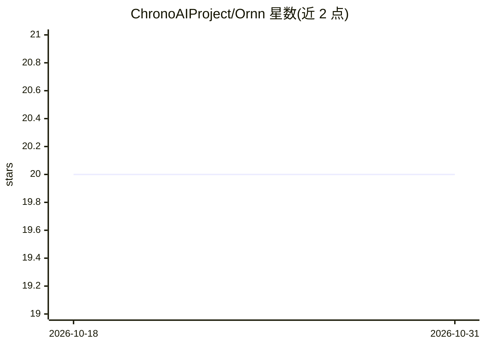

# ChronoAIProject/Ornn

⭐ 20 · TypeScript · Apache-2.0 · 推送 2026-09-28 · [GitHub](https://github.com/ChronoAIProject/Ornn) · [官网](https://ornn.chrono-ai.fun) · 组织维护

**面向 AI agent 的技能全生命周期 API 服务**

以 HTTP 与 MCP 接口向 AI agent 提供技能的 search→pull→install→execute→build→upload→share 全生命周期 API，模型与运行时无关（Claude、GPT、Gemini 或自建运行时）。身份认证与请求代理由 nyxid 层承担，agent 不持有长期令牌。主要用户是 agent 开发者与 agentic 系统构建者，ornn-web 为技能所有者与管理员的辅助界面。项目自述处于 alpha 状态，API 在 v1 前可能变更，生产使用需固定 release tag。通过 ornn-agent-manual-cli 将操作手册装入 agent 完成接入。

## 筛选速览

| 维度 | 判定 | 备注 |
|---|---|---|
| AI 角色 | `ai-ecosystem` | LLM/agent 周边工具 |
| 许可风险 | `permissive` | Apache-2.0 |
| 部署形态 | `None` |  |
| 模型依赖 | — | README 未给出锁定关系 |
| 硬件要求 | — | 无带数字的原话,不猜 |
| 安装摩擦 | `low` | 无编译、无系统依赖或容器化 |
| 成熟度 | `idea` | |

## 能力要点

- HTTP 与 MCP 双通道供 agent 直接调用
- 覆盖技能 search→pull→execute→build→upload→share 的单 API 生命周期
- 模型与运行时无关的稳定 schema
- nyxid 身份层透明刷新凭证并按请求代理服务访问

## 适用场景

- 让 AI agent 用自然语言搜索并安装注册表中的技能
- 通过 ornn-build 生成、打包并发布新技能版本
- 对已发布技能触发安全审计（静态分析、沙箱探测、依赖扫描）

## 场景标签

`Agent 框架` · 领域:Agent 开发

## 证据(README 行号)

> L16:  The agent-facing skill-lifecycle API for AI agents.
> L34: Ornn is an **agent-facing skill-lifecycle API**, not a human marketplace.
> L40: Closest analog: **npm registry + npm CLI fused, model-agnostic**. The primary consumer is the AI agent developer / 

## 星数曲线

2026-10-18 20 → 2026-10-31 20（+0）

---
*卡片 v1 · prompt 1.4 · 生成 2026-10-28 · 置信度 mid · 依据 README sha `2c3fe4ea4b06` · [字段定义](../../DATASET.md)*
