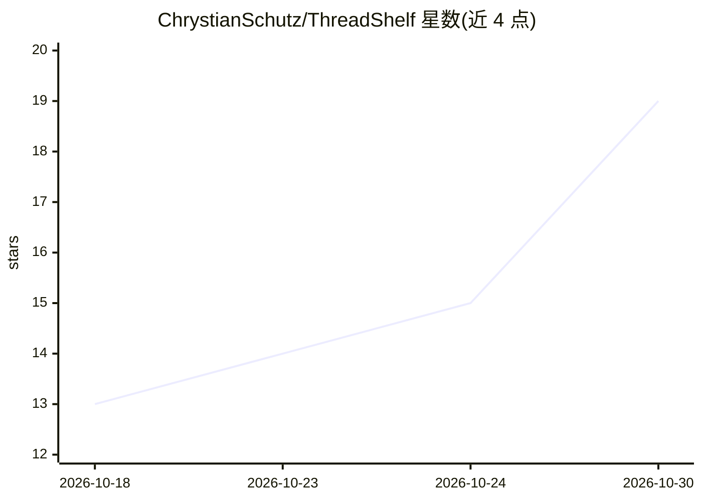

# ChrystianSchutz/ThreadShelf

⭐ 19 · TypeScript · MIT · 推送 2026-10-28 · [GitHub](https://github.com/ChrystianSchutz/ThreadShelf) · [官网](https://chrystianschutz.github.io/ThreadShelf/) · 个人维护

**本地优先的 AI 对话归档、语义搜索与续写工具**

面向使用多个 AI 服务的用户：导入 ChatGPT、Claude、Google AI Studio、OpenRouter、LM Studio、Grok 的对话导出 JSON，本地解析归一化、本地多语言嵌入并存入 LanceDB，随后可在 Web UI、CLI、HTTP API 或 MCP stdio 服务器上按语义或精确匹配检索旧对话、重建完整线程、导出 Markdown。续写为可选功能：通过本地 llama.cpp（仅环回）运行 GGUF 模型，或明确标注为外部的 OpenRouter 通道；另支持连接 Obsidian/Markdown 文件夹做笔记搜索与工具调用，写入默认关闭。注意多家导出格式无官方文档，解析依赖特定版本快照。

## 筛选速览

| 维度 | 判定 | 备注 |
|---|---|---|
| AI 角色 | `ai-native` | 本体是模型或模型工具 |
| 许可风险 | `permissive` | MIT |
| 部署形态 | `desktop` | 安装包/桌面程序 |
| 模型依赖 | local-ok | 支持本地模型 |
| 硬件要求 | — | 无带数字的原话,不猜 |
| 安装摩擦 | `medium` | 含编译或系统依赖之一 |
| 成熟度 | — | 结构信号不足 |

## 能力要点

- 六家 AI 服务的对话导出归一化为统一本地归档
- 本地嵌入 + LanceDB 的语义与精确双模式检索，同一索引供 Web UI/CLI/HTTP API/MCP 使用
- 可选续写：本地 llama.cpp（loopback-only）或显式标注外部的 OpenRouter
- 连接 Obsidian/Markdown 文件夹的本地搜索与受控笔记读写（默认只读）

## 适用场景

- 我想把散落各处的 AI 聊天记录汇成一个可搜索的本地库
- 忘了原话也能按语义找到旧对话并打开完整上下文
- 在本地用 GGUF 模型继续归档过的对话
- 让现有 MCP 客户端检索我过去的对话上下文

## 场景标签

`语义搜索` · 领域:知识与检索

## 证据(README 行号)

> L10: One private workspace across **ChatGPT, Claude, Google AI Studio, OpenRouter,
> L40: 2. ThreadShelf parses them into a common format, embeds them **locally**, and
> L44: 4. Optionally start a new chat or continue an archived thread through local

## 星数曲线

2026-10-18 13 → 2026-10-30 19（+6）

---
*卡片 v1 · prompt 1.4 · 生成 2026-10-30 · 置信度 high · 依据 README sha `6965307cf1dd` · [字段定义](../../DATASET.md)*
