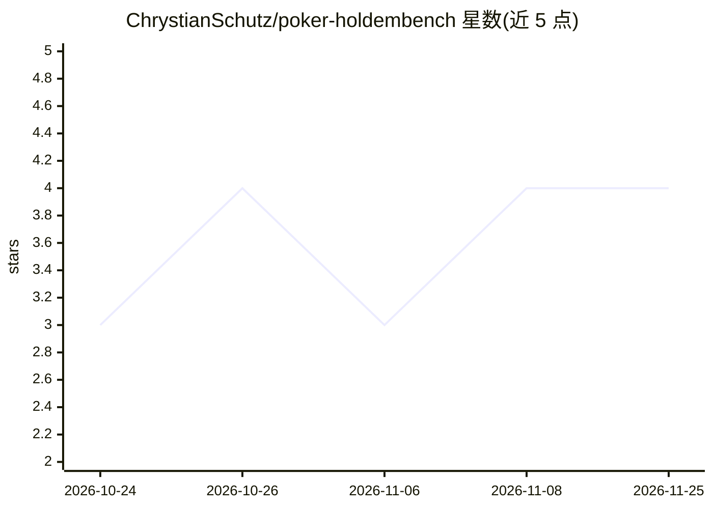

# ChrystianSchutz/poker-holdembench

⭐ 4 · Python · MIT · 推送 2026-10-17 · [GitHub](https://github.com/ChrystianSchutz/poker-holdembench) · [官网](https://chrystianschutz.com/blog/ai-poker-holdembench/) · 个人维护

**面向 AI 研究者的单挑无限注德州扑克评测基准**

HoldemBench 用重复发牌的单挑无限注德州扑克测量 AI agent 的出牌水平与行为特征。通过 OpenRouter 接入决策模型、廉价与前沿 LLM，本地模型经 OpenAI 兼容服务器（llama.cpp）运行，另含随机/性格机器人作参照；所有玩家共用同一动作菜单。共 17 个玩家、7,729 手牌、$16.44 API 开销。设计要点：重复发牌消除牌运、PokerKit 执行规则、Bradley–Terry Elo 与 bootstrap 区间、预算硬上限与熔断机制、VPIP/一致性探测等行为指标。以 uv 管理 Python 工程，原始数据发布于 Hugging Face。

## 筛选速览

| 维度 | 判定 | 备注 |
|---|---|---|
| AI 角色 | `ai-knowledge` | 知识聚合/清单类 |
| 许可风险 | `permissive` | MIT |
| 部署形态 | `None` |  |
| 模型依赖 | locked-api |  |
| 硬件要求 | — | 无带数字的原话,不猜 |
| 安装摩擦 | `low` | 无编译、无系统依赖或容器化 |
| 成熟度 | — | 结构信号不足 |

## 能力要点

- 重复发牌设计：每副牌换位打两次，牌运相互抵消
- 五类玩家（决策模型/廉价 LLM/前沿 LLM/本地模型/机器人）共用同一动作菜单
- 预算硬上限预留与熔断器，防 fallback 冒充对局
- 行为指标：VPIP、PFR、3-bet、一致性探测、等价性重标注探测

## 适用场景

- 以低 API 成本对比不同 LLM 在复杂决策任务上的表现
- 评估本地小模型与商用模型的决策能力差距
- 复现基准结果并生成排行榜报告

## 场景标签

`模型评测` · 领域:评测与运维

## 证据(README 行号)

> L8: **Duplicate heads-up hold'em for decision models, cheap and frontier LLMs, local models and classic poker bots.**
> L11: they play, for cents per model. It compares five families through one identical action
> L53: * **Duplicate poker.** Every deal is played twice with seats swapped, and every pairing

## 星数曲线

2026-10-24 3 → 2026-11-25 4（+1）

---
*卡片 v1 · prompt 1.4 · 生成 2026-11-21 · 置信度 high · 依据 README sha `1f46548449b6` · [字段定义](../../DATASET.md)*
