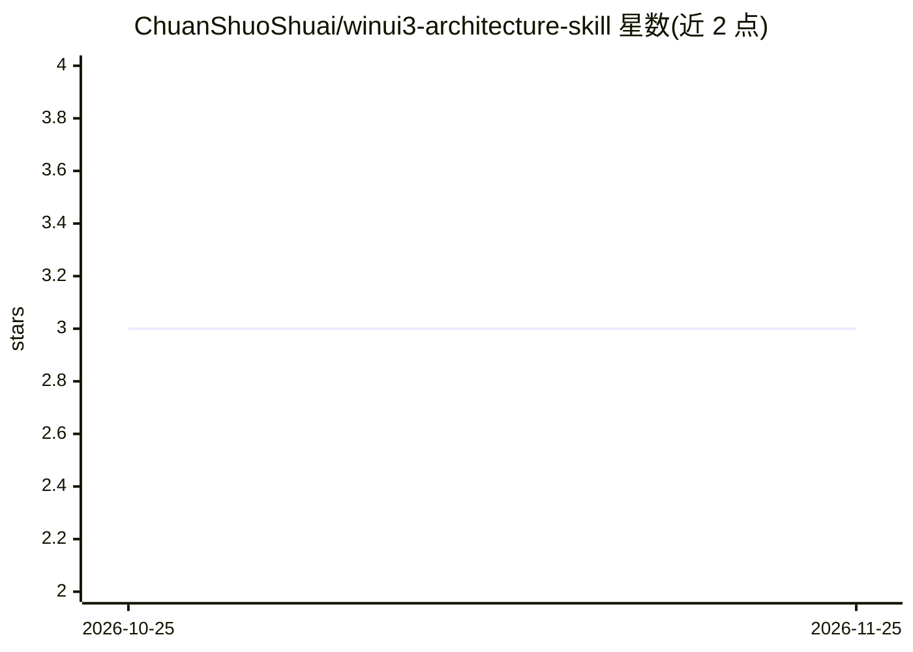

# ChuanShuoShuai/winui3-architecture-skill

⭐ 3 · C# · MIT · 推送 2026-10-20 · [GitHub](https://github.com/ChuanShuoShuai/winui3-architecture-skill) · [官网](https://yinhu.sgguo.com) · 个人维护 · 中文 README

**给 AI Agent 提供生产级 WinUI 3 架构规范的技能包**

将一套经生产环境使用的 WinUI 3 桌面应用架构封装为 Agent Skill 包，含英文与简体中文两个对等版本和共用模板骨架。安装后，Claude Code / Codex / Cursor 等 Agent 在新建或改造 WinUI 3 项目时自动加载该技能，按同一套架构原则写代码，并规避文档中列出的编译期不报错、运行期崩溃的陷阱清单。覆盖启动单实例、崩溃日志、XAML 陷阱等参考文档与验收清单。要求 Windows 10 1809+、.NET 10 SDK、Windows App SDK 1.7+。

## 筛选速览

| 维度 | 判定 | 备注 |
|---|---|---|
| AI 角色 | `ai-knowledge` | 知识聚合/清单类 |
| 许可风险 | `permissive` | MIT |
| 部署形态 | `library` | 以包/库形式分发 |
| 模型依赖 | — | README 未给出锁定关系 |
| 硬件要求 | — | 无带数字的原话,不猜 |
| 安装摩擦 | `medium` | 含编译或系统依赖之一 |
| 成熟度 | — | 结构信号不足 |

## 能力要点

- 英文与简体中文两个对等版本，共用同一套模板骨架
- 一条 npx skills add 命令安装，支持数十种 Agent 工具
- SKILL.md + references 文档：架构总览、搭建顺序、硬规矩、验收清单
- 列出 x:Name 重名、ThemeResource 缺失、ContentDialog 嵌套等运行期陷阱

## 适用场景

- 让 AI 编码助手按统一架构新建 WinUI 3 项目
- 改造存量 WinUI 3 项目时规避运行期崩溃陷阱
- 中文或英文对话环境下加载对应语言版本的技能

## 场景标签

`编码 Agent` · 领域:编码与开发

## 证据(README 行号)

> L3: 把一套跑过生产环境的 WinUI 3 桌面应用架构，封装成可以直接被 AI Agent 加载的 Skill。
> L9: 这是一个 WorkBuddy / Claude Code 风格的 **Skill 包**。装上之后，
> L55: SKILL.md                      架构总览、搭建顺序、硬规矩、验收清单

## 星数曲线

2026-10-25 3 → 2026-11-25 3（+0）

---
*卡片 v1 · prompt 1.4 · 生成 2026-11-22 · 置信度 high · 依据 README sha `966b69074ff5` · [字段定义](../../DATASET.md)*
