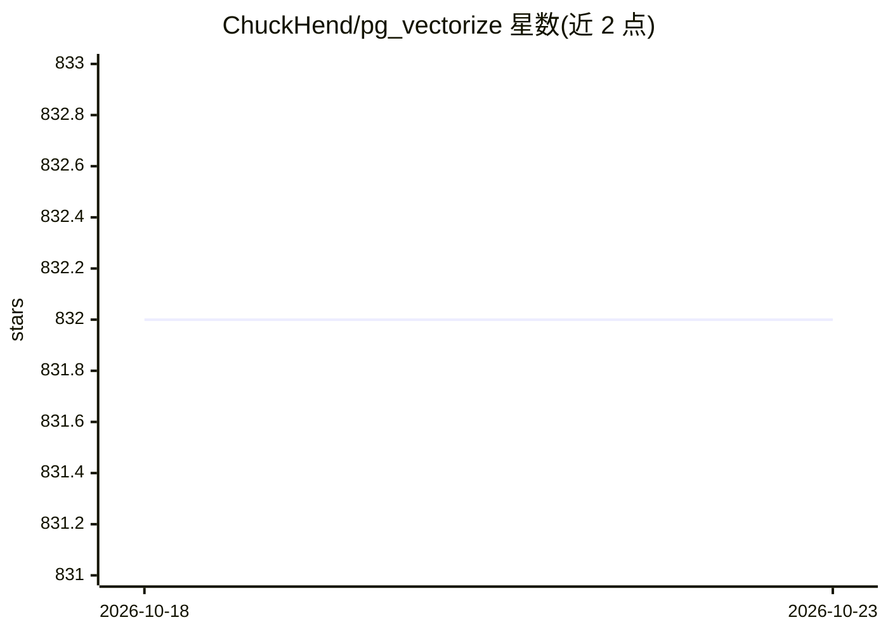

# ChuckHend/pg_vectorize

⭐ 832 · Rust · 推送 2026-10-16 · [GitHub](https://github.com/ChuckHend/pg_vectorize) · [官网](https://chuckhend.github.io/pg_vectorize/) · 个人维护

**在 Postgres 上自动做向量/全文/混合搜索的扩展与 HTTP 服务**

由 Postgres 扩展与独立 HTTP 服务两种形态组成：自动完成文本到 embedding 的转换与后台编排（基于 pgmq），持续监听数据更新，提供向量、全文与混合检索，支持在 Postgres 上构建 RAG 与搜索引擎。HTTP 服务面向托管数据库（RDS、Cloud SQL 等），仅需数据库内有 pgvector；扩展形态提供 SQL API（vectorize.table()、vectorize.search()）。依赖 pgvector、pgmq 与 SentenceTransformers 的工作。

## 筛选速览

| 维度 | 判定 | 备注 |
|---|---|---|
| AI 角色 | `ai-ecosystem` | LLM/agent 周边工具 |
| 许可风险 | `none` | — |
| 部署形态 | `self-host` | docker 或自建部署 |
| 模型依赖 | — | README 未给出锁定关系 |
| 硬件要求 | — | 无带数字的原话,不猜 |
| 安装摩擦 | `low` | 无编译、无系统依赖或容器化 |
| 成熟度 | — | 结构信号不足 |

## 能力要点

- 自动转换文本为 embeddings 并持续监听数据更新
- 向量/全文/混合三种检索方式
- HTTP server 与 Postgres 扩展两种部署形态
- REST API（POST /api/v1/table、GET /api/v1/search）与 SQL API 双入口

## 适用场景

- 在托管 Postgres（RDS/Cloud SQL）上快速加语义搜索
- 自建 Postgres 上用 SQL 构建 RAG 检索
- 对已有业务表自动生成并维护向量索引

## 场景标签

`语义搜索` `RAG` · 领域:知识与检索

## 证据(README 行号)

> L5: A Postgres server and extension that automates the transformation and orchestration of text to embeddings and provid
> L15: pg_vectorize provides two ways to add semantic, full text, and hybrid search to any Postgres making it easy to buil

## 星数曲线

2026-10-18 832 → 2026-10-23 832（+0）

---
*卡片 v1 · prompt 1.4 · 生成 2026-10-21 · 置信度 high · 依据 README sha `302dc179cece` · [字段定义](../../DATASET.md)*
