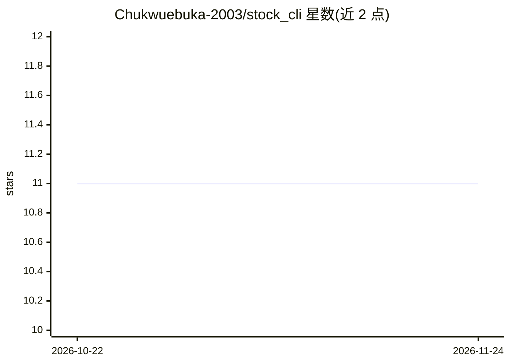

# Chukwuebuka-2003/stock_cli

⭐ 11 · Python · MIT · 推送 2026-03-06 · [GitHub](https://github.com/Chukwuebuka-2003/stock_cli) · 个人维护

**给个人投资者的股票持仓跟踪 CLI，附 AI 分析报告**

Python 编写的命令行工具：管理股票持仓与关注清单，通过 Alpha Vantage API 获取实时价格，调用 Groq 的 llama-3.3-70b-versatile 生成投资分析报告，可经邮件发送 HTML 报告。附带 Streamlit 交互式仪表盘（K 线图、RSI/MACD/布林带等技术指标、买卖信号）、持仓历史快照、价格提醒。支持 Docker 部署与 GitHub Actions 定时/事件触发报告（集成 Tavily 市场事件检测），15 分钟缓存减少 API 调用。需自备 Groq 与 Alpha Vantage API key。

## 筛选速览

| 维度 | 判定 | 备注 |
|---|---|---|
| AI 角色 | `ai-native` | 本体是模型或模型工具 |
| 许可风险 | `permissive` | MIT |
| 部署形态 | `self-host` | docker 或自建部署 |
| 模型依赖 | locked-api |  |
| 硬件要求 | — | 无带数字的原话,不猜 |
| 安装摩擦 | `low` | 无编译、无系统依赖或容器化 |
| 成熟度 | — | 结构信号不足 |

## 能力要点

- 调用 Groq llama-3.3-70b-versatile 生成持仓分析报告
- Streamlit 仪表盘提供 K 线图与 RSI/MACD/布林带指标
- GitHub Actions 定时与市场事件触发报告，Docker 容器化运行
- 价格提醒、关注清单与持仓历史快照

## 适用场景

- 命令行跟踪我的股票持仓与盈亏
- 定期自动生成带 AI 分析的邮件报告
- 用交互图表查看个股技术指标与买卖信号

## 场景标签

`金融量化` · 领域:学习与行业

## 证据(README 行号)

> L11: A command-line tool to track your stock portfolio and get AI-powered investment analysis.
> L18: - 🤖 **AI Analysis**: Get intelligent insights using Groq's LLM (llama-3.3-70b-versatile)
> L113: stock-tracker ai-report [--email EMAIL]

## 星数曲线

2026-10-22 11 → 2026-11-24 11（+0）

---
*卡片 v1 · prompt 1.4 · 生成 2026-11-19 · 置信度 high · 依据 README sha `4d5d1f058f9b` · [字段定义](../../DATASET.md)*
