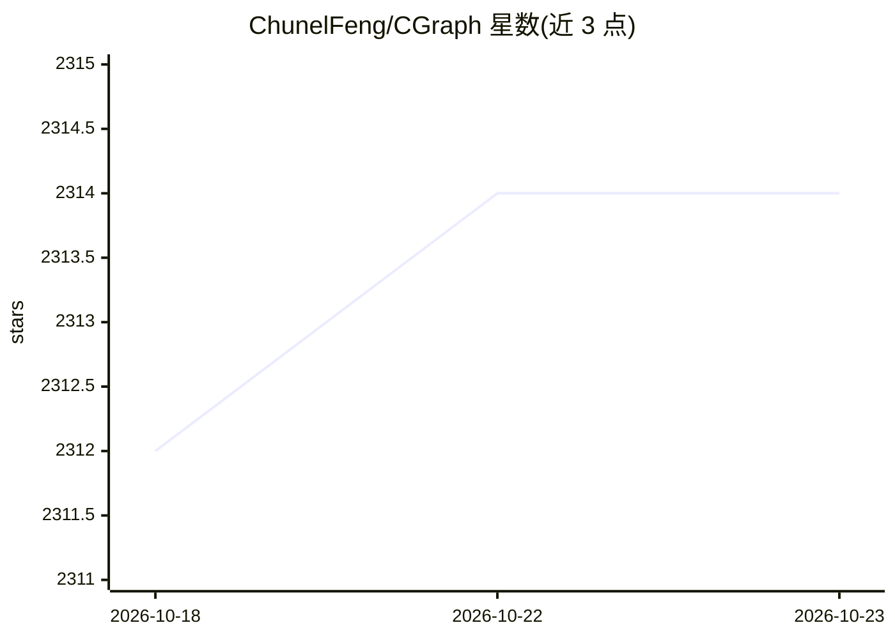

# ChunelFeng/CGraph

⭐ 2,314 · C++ · MIT · 推送 2026-10-22 · [GitHub](https://github.com/ChunelFeng/CGraph) · [官网](http://www.chunel.cn) · 个人维护 · 中文 README

**纯 C++/Python 的跨平台 DAG 图流程并行执行框架**

一套无任何第三方依赖、基于 C++11 标准库的跨平台有向无环图（DAG）流程执行框架，兼容 macOS、Linux、Windows 和 Android。使用者继承 GNode 节点类实现 run() 方法并设定依赖关系，即可实现任务图化/流水线执行；通过 GPipeline 底层调度提供依赖依次执行、非依赖并发执行，以及暂停、恢复、超时设定的 eDAG 调度。支持 GGroup 控制条件判断、循环和并发逻辑。另提供 Python 版本 pycgraph（pip 安装），支持 C++/Python 混合编程，并有 C#、Java、Go 等其他语言版本。

## 筛选速览

| 维度 | 判定 | 备注 |
|---|---|---|
| AI 角色 | `ai-ecosystem` | LLM/agent 周边工具 |
| 许可风险 | `permissive` | MIT |
| 部署形态 | `self-host` | docker 或自建部署 |
| 模型依赖 | — | README 未给出锁定关系 |
| 硬件要求 | — | 无带数字的原话,不猜 |
| 安装摩擦 | `low` | 无编译、无系统依赖或容器化 |
| 成熟度 | — | 结构信号不足 |

## 能力要点

- 纯 C++11 编写，无任何第三方依赖，跨四平台
- eDAG 调度：依赖依次执行、非依赖并发、暂停/恢复/超时
- Python 版 pycgraph 支持 pip3 install 安装与混合编程
- 提供 aspect 切面、message 消息、perf 性能分析、docker 环境等功能

## 适用场景

- 用图结构编排任务依赖与并发执行逻辑
- 构建多线程流水线并进行调度资源管控
- C++/Python 混合开发场景下的流程编排

## 场景标签

`工作流自动化` · 领域:效率与自动化

## 证据(README 行号)

> L16: > CGraph is a cross-platform D irected A cyclic G raph framework based on pure C++ without any 3rd-party dependenci
> L22: `CGraph`中文名为【色丶图】，是一套无任何第三方依赖的跨平台图流程执行框架。通过`GPipeline`(流水线)底层调度，提供了包含依赖元素依次执行、非依赖元素并发执行，支持暂停、恢复、超时设定的 `eDAG` 调度功能。

## 星数曲线

2026-10-18 2,312 → 2026-10-23 2,314（+2）

---
*卡片 v1 · prompt 1.4 · 生成 2026-10-21 · 置信度 mid · 依据 README sha `dd8a22ee6fb1` · [字段定义](../../DATASET.md)*
