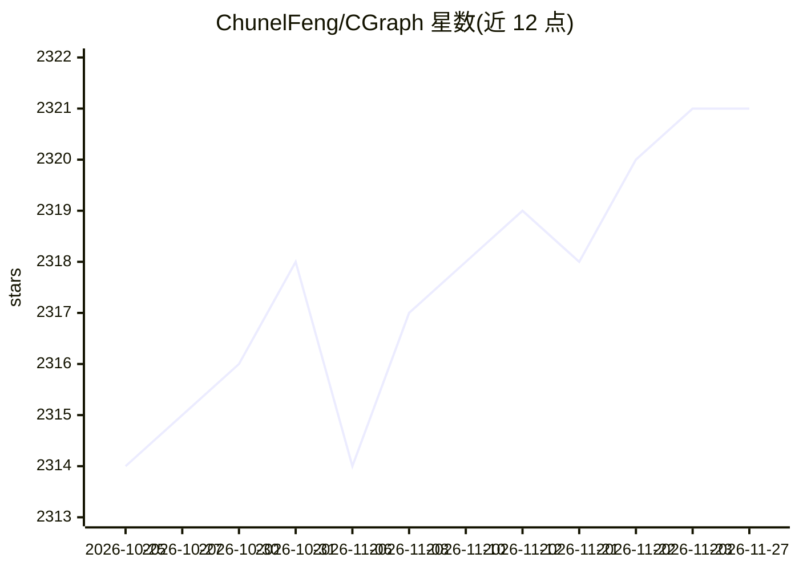

# ChunelFeng/CGraph

⭐ 2,321 · C++ · MIT · 推送 2026-11-23 · [GitHub](https://github.com/ChunelFeng/CGraph) · [官网](http://www.chunel.cn) · 个人维护 · 中文 README

**给开发者用的无依赖跨平台 C++/Python DAG 流程框架**

CGraph（色丶图）是一套基于纯 C++11 的图流程执行框架，无第三方依赖，兼容 macOS/Linux/Windows/Android。使用者继承 GNode 并实现 run()、设定依赖关系，即可实现任务的图化或流水线执行，通过 GPipeline 调度支持依赖串行、非依赖并发、条件、循环、超时、暂停恢复等机制，并提供 group/aspect/param/message/event 等扩展模块。提供 Python 版 pycgraph（pip 安装）以及 C#/Java/Go 的同接口实现，另有 dockerfile 构建环境与性能分析 perf 功能。

## 筛选速览

| 维度 | 判定 | 备注 |
|---|---|---|
| AI 角色 | `ai-ecosystem` | LLM/agent 周边工具 |
| 许可风险 | `permissive` | MIT |
| 部署形态 | `self-host` | docker 或自建部署 |
| 模型依赖 | — | README 未给出锁定关系 |
| 硬件要求 | — | 无带数字的原话,不猜 |
| 安装摩擦 | `low` | 无编译、无系统依赖或容器化 |
| 成熟度 | — | 结构信号不足 |

## 能力要点

- 纯 C++11 标准库实现，无第三方依赖，跨四大平台
- 支持依赖串行、并发、条件、循环、超时、暂停/恢复等 DAG 调度
- 提供 Python 版 pycgraph，支持 Python/C++ 混合编程
- 提供 graphviz 可视化、perf 性能分析与一键编译脚本

## 适用场景

- 将多阶段任务编排为依赖图并行执行
- 用 Python 搭建可暂停/超时控制的流水线
- 对多线程调度性能做分析与优化实验

## 场景标签

`工作流自动化` · 领域:效率与自动化

## 证据(README 行号)

> L16: > CGraph is a cross-platform D irected A cyclic G raph framework based on pure C++ without any 3rd-party dependenci
> L22: `CGraph`中文名为【色丶图】，是一套无任何第三方依赖的跨平台图流程执行框架。通过`GPipeline`(流水线)底层调度，提供了包含依赖元素依次执行、非依赖元素并发执行，支持暂停、恢复、超时设定的 `eDAG` 调度功能。

## 星数曲线

2026-10-25 2,314 → 2026-11-27 2,321（+7）

---
*卡片 v1 · prompt 1.4 · 生成 2026-11-23 · 置信度 mid · 依据 README sha `90e68a09bf94` · [字段定义](../../DATASET.md)*
