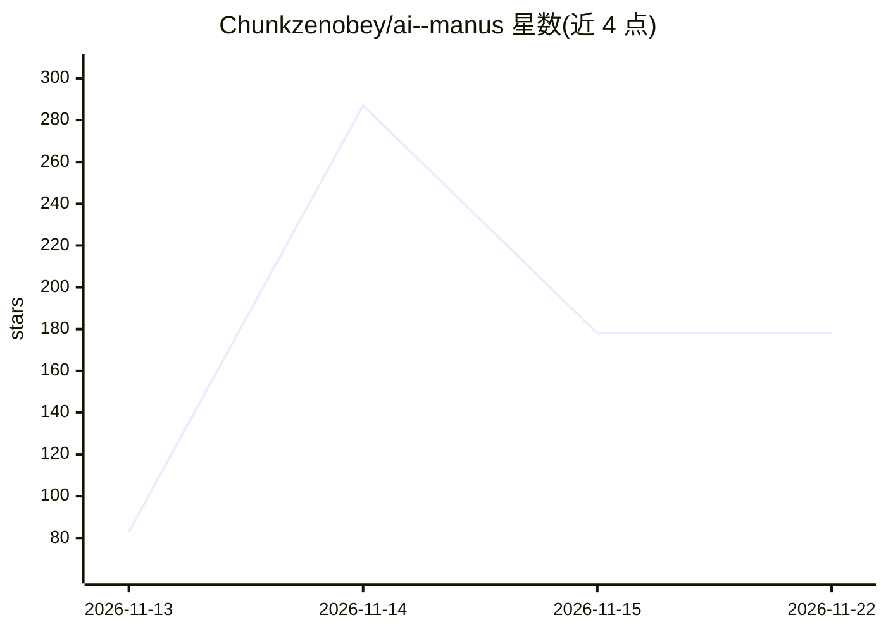

# Chunkzenobey/ai--manus

⭐ 178 · Apache-2.0 · 推送 2026-11-15 · [GitHub](https://github.com/Chunkzenobey/ai--manus) · 个人维护

**面向个人用户的自主 AI Agent，代跑代码与控制浏览器**

定位为通用型自主 AI 代理：在沙箱环境中运行代码、控制浏览器（导航网页、填写表单、采集信息），并执行多步日常任务，目标用户为学生、远程工作者与轻量办公场景。README 描述了配置与使用流程（配置触发器、小任务试运行、逐步扩大自动化范围），并给出系统兼容性表（最低双核 CPU、4 GB 内存）。限制：README 未给出任何具体安装命令、技术栈细节或 API 接入方式，仅含 'Download Manus' 与 'PROMO2026' 等推广性内容。

## 筛选速览

| 维度 | 判定 | 备注 |
|---|---|---|
| AI 角色 | `ai-native` | 本体是模型或模型工具 |
| 许可风险 | `permissive` | Apache-2.0 |
| 部署形态 | `None` |  |
| 模型依赖 | — | README 未给出锁定关系 |
| 硬件要求 | — | 无带数字的原话,不猜 |
| 安装摩擦 | `low` | 无编译、无系统依赖或容器化 |
| 成熟度 | — | 结构信号不足 |

## 能力要点

- 自主执行代码与脚本运行
- 浏览器控制：导航、填表、信息采集
- 多步骤任务的低监督执行
- 会话间保持一致的任务模式

## 适用场景

- 让代理代跑小脚本与快速实验
- 自动浏览网页、填写重复表单、多页采集数据
- 整理研究笔记与日常杂务自动化

## 场景标签

`AI 助手` `浏览器自动化` · 领域:效率与自动化

## 证据(README 行号)

> L10: - **Autonomous Code Execution:** Manus AI agent runs code on its own to complete tasks, so you can focus on decisio
> L18: Manus is an autonomous AI agent designed to run code and control a browser on your behalf. Instead of acting like a

## 星数曲线

2026-11-13 83 → 2026-11-22 178（+95）

---
*卡片 v1 · prompt 1.4 · 生成 2026-11-17 · 置信度 mid · 依据 README sha `0f78ee3a5dd2` · [字段定义](../../DATASET.md)*
