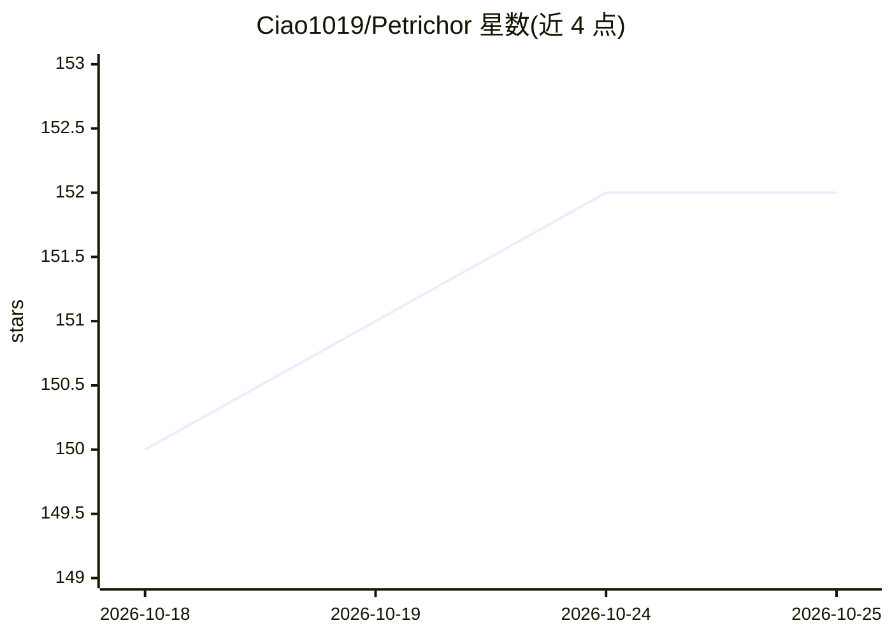

# Ciao1019/Petrichor

⭐ 153 · TypeScript · Apache-2.0 · 推送 2026-09-29 · [GitHub](https://github.com/Ciao1019/Petrichor) · [官网](https://petrichor.wl.do) · 个人维护 · 中文 README

**自托管知识平台：Markdown 编译语义 Wiki，供人与 AI Agent 使用**

开源、自托管的知识平台：用 Markdown 写作，将内容编译成语义 Wiki（实体、概念、关系抽取），并通过 Agentic RAG 生成带 Evidence/Trace 的可追溯回答。面向个人与团队发布 Wiki、博客与 Agent Skill 包，对外提供 REST、MCP、API Key 与审计。内部含 Pi Agent Runtime（站内助手、公开问答、子 Agent），并支持外部 MCP Client、SKILL.md、代码沙箱与浏览器执行。部署方式为 Docker Compose（PostgreSQL 16+ 需自带并启用 pgvector），模型供应商按用途自行配置。

## 筛选速览

| 维度 | 判定 | 备注 |
|---|---|---|
| AI 角色 | `ai-native` | 本体是模型或模型工具 |
| 许可风险 | `permissive` | Apache-2.0 |
| 部署形态 | `self-host` | docker 或自建部署 |
| 模型依赖 | — | README 未给出锁定关系 |
| 硬件要求 | — | 无带数字的原话,不猜 |
| 安装摩擦 | `low` | 无编译、无系统依赖或容器化 |
| 成熟度 | — | 结构信号不足 |

## 能力要点

- Markdown → 结构切片 → 语义 Wiki 编译，保留来源引用与新鲜度指纹
- Agentic RAG：Search/Outline 定位 + Read 深读形成 Evidence，BM25/Vector/Wiki 融合召回
- Pi Agent Runtime：站内助手、公开问答、子 Agent，计划/预算/权限由 Go 掌控
- 导出 OKF、Obsidian 与可安装 Agent Skill 包，提供 REST/MCP 接入与调用审计

## 适用场景

- 搭建个人或团队的自托管知识库并发布 Wiki 与博客
- 让 AI Agent 通过 MCP 或 Skill 包正确调用我的知识
- 对文档做可追溯的公开问答而非黑箱检索

## 场景标签

`知识库管理` `RAG` `文档问答` · 领域:知识与检索

## 证据(README 行号)

> L7: **开源、自托管的知识平台：用 Markdown 写作，把内容编译成语义 Wiki，\
> L40: - **Agentic RAG** — 标题感知切片、推荐问题、BM25 / Vector / Wiki 融合、目录导航、Evidence / Trace。
> L42: - **Pi Agent Runtime** — 站内助手、前台公开问答、子 Agent 与 Wiki 文档 Agent 统一基于 Pi Agent Core；计划、动态 Skill、预算、Evidence 与权限由 Go 掌控，

## 星数曲线

2026-10-18 150 → 2026-10-25 152（+2）

---
*卡片 v1 · prompt 1.4 · 生成 2026-10-22 · 置信度 high · 依据 README sha `9d531523684a` · [字段定义](../../DATASET.md)*
