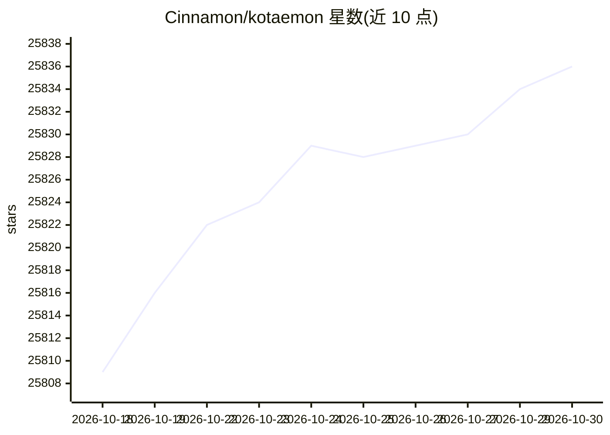

# Cinnamon/kotaemon

⭐ 25,836 · Python · Apache-2.0 · 推送 2026-07-14 · [GitHub](https://github.com/Cinnamon/kotaemon) · [官网](https://cinnamon.github.io/kotaemon/) · 组织维护

**面向终端用户与开发者的开源 RAG 文档问答 UI**

提供开箱即用的 RAG 文档问答 Web UI 与供开发者构建自定义 RAG pipeline 的框架。面向想对文档做问答的终端用户和想自建 RAG 流水线的开发者。关键机制包括混合检索（全文+向量）加重排序、带 PDF 高亮预览的引用展示、多模态文档解析选项，以及可扩展的 GraphRAG 索引示例。限制方面：Python 3.10+，处理 pdf/html/mhtml/xlsx 之外的文件需另装 Unstructured，非 Docker 安装涉及较多环境配置步骤。

## 筛选速览

| 维度 | 判定 | 备注 |
|---|---|---|
| AI 角色 | `ai-native` | 本体是模型或模型工具 |
| 许可风险 | `permissive` | Apache-2.0 |
| 部署形态 | `desktop` | 安装包/桌面程序 |
| 模型依赖 | local-ok | 支持本地模型 |
| 硬件要求 | — | 无带数字的原话,不猜 |
| 安装摩擦 | `low` | 无编译、无系统依赖或容器化 |
| 成熟度 | — | 结构信号不足 |

## 动量与使用信号

- 维护:`maintenance` — 距上次 push 95.6 天,年发版 4,39 位贡献者
- 涨星:近 1 天 **+3**(自 20261016 起算)
- 安装:pypi 包 `nano-graphrag` 月下载 731
- 平台:— · 协议:OPENAI-API / OLLAMA

## 能力要点

- 混合 RAG 流水线：全文+向量检索加重排序
- 浏览器内 PDF 引用预览与相关度分数展示
- 支持多模态文档解析与图表问答
- 提供 GraphRAG/LightRAG 等索引接入示例

## 适用场景

- 自托管一个文档问答系统并支持多用户协作
- 在 Gradio UI 上调试自己的 RAG 流水线
- 通过 Ollama 或 llama-cpp-python 在本地离线做文档问答
- 对含图表表格的文档做多模态问答

## 场景标签

`文档问答` `RAG` · 领域:知识与检索

## 证据(README 行号)

> L30: This project serves as a functional RAG UI for both end users who want to do QA on their
> L43: - **Support for Various LLMs**: Compatible with LLM API providers (OpenAI, AzureOpenAI, Cohere, etc.) and local LLM
> L48: - **Framework for RAG Pipelines**: Tools to build your own RAG-based document QA pipeline.

## 星数曲线

2026-10-18 25,809 → 2026-10-30 25,836（+27）

---
*卡片 v1 · prompt 1.4 · 生成 2026-10-18 · 置信度 mid · 依据 README sha `7f841ce4f4ab` · [字段定义](../../DATASET.md)*
