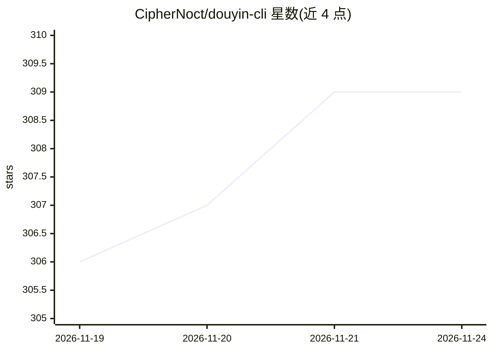

# CipherNoct/douyin-cli

⭐ 310 · JavaScript · MIT · 推送 2026-11-21 · [GitHub](https://github.com/CipherNoct/douyin-cli) · 个人维护 · 中文 README

**给抖音账号运营者的评论管理 CLI：抓评论并用 AI 生成回复**

基于 Bridge Framework（本地 Bridge Server + 油猴脚本注入页面上下文）的命令行工具，面向代管自有抖音账号的运营场景：搜索视频、拉取全量评论与嵌套回复、发表文本/图片评论、点赞、下载视频，并通过 ReplyEngine 与 7 种人格轮换生成 AI 回复。内置随机延迟、请求参数随机化、风控断路器与 SQLite 持久化记忆（语料去重、失败模式避雷、Token 用量追踪），提供本地 HTML 运营仪表盘。依赖 Node.js 18+、Chrome 与 Tampermonkey，需登录态浏览器与 LLM API key。

## 筛选速览

| 维度 | 判定 | 备注 |
|---|---|---|
| AI 角色 | `ai-enhanced` | 去掉 AI 部分产品仍成立 |
| 许可风险 | `permissive` | MIT |
| 部署形态 | `library` | 以包/库形式分发 |
| 模型依赖 | — | README 未给出锁定关系 |
| 硬件要求 | — | 无带数字的原话,不猜 |
| 安装摩擦 | `medium` | 含编译或系统依赖之一 |
| 成熟度 | — | 结构信号不足 |

## 能力要点

- ReplyEngine 生成引擎：3 种模式、人格绑定、L1-L3 上下文隔离
- Anthropic 与 OpenAI 兼容双 Provider 接入，按 base_url 自动检测
- 行为模拟与随机延迟等节奏化设计，写操作 40-55s 硬强制
- SQLite 记忆层含回复语料去重、失败模式统计与推广活动引擎

## 适用场景

- 批量抓取自己视频下的评论并分析情感与优先级
- 用 AI 生成不同人格风格的评论回复并经草稿确认后发布
- 多账号矩阵代管时按账号路由读写操作
- 生成运营仪表盘查看活动与账号行为记录

## 场景标签

`浏览器自动化` `AI 写作` · 领域:效率与自动化

## 证据(README 行号)

> L8: > 抖音评论运营 CLI 工具。基于 Bridge Framework（Bridge Server + 油猴脚本），支持视频搜索、评论获取、**AI 人格化回复**、**ReplyEngine 独立生成**、**草稿管理**、运营仪
> L32: |🤖 **AI 人格化回复**|7 种人格自动轮换，A-F 六类回复策略，避免"AI 味"|
> L268: - `lib/llm.js` — LLM 客户端（OpenAI + Anthropic 双 Provider，A-F 策略，Token 追踪）

## 星数曲线

2026-11-19 306 → 2026-11-24 309（+3）

---
*卡片 v1 · prompt 1.4 · 生成 2026-11-19 · 置信度 high · 依据 README sha `3d041fbc5155` · [字段定义](../../DATASET.md)*
