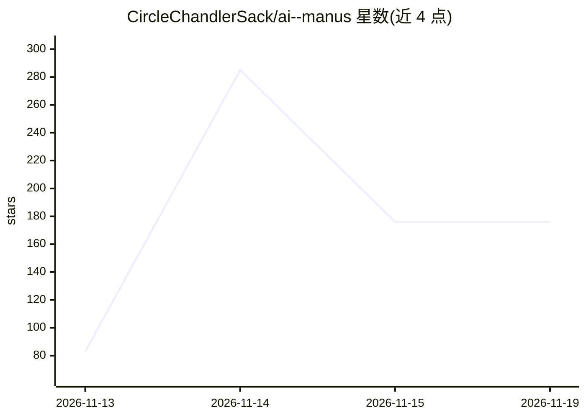

# CircleChandlerSack/ai--manus

⭐ 176 · Apache-2.0 · 推送 2026-11-15 · [GitHub](https://github.com/CircleChandlerSack/ai--manus) · 个人维护

**自主 AI Agent 系统：在沙箱中运行代码并控制浏览器**

Manus 是面向终端用户的自主 AI Agent，可在沙箱环境中自主执行代码、控制浏览器完成多步任务，覆盖日常任务自动化、研究整理、轻量办公与开发测试等场景。核心机制为代码执行与浏览器操作结合于同一工作流，用户以自然指令描述需求，由 Agent 拆解并执行步骤。README 仅给出组件兼容表（4 GB 内存起步）与使用流程说明，未提供安装命令、源码结构或 API 接入方式，面向家庭、学习与小规模任务用户。

## 筛选速览

| 维度 | 判定 | 备注 |
|---|---|---|
| AI 角色 | `ai-native` | 本体是模型或模型工具 |
| 许可风险 | `permissive` | Apache-2.0 |
| 部署形态 | `None` |  |
| 模型依赖 | — | README 未给出锁定关系 |
| 硬件要求 | — | 无带数字的原话,不猜 |
| 安装摩擦 | `low` | 无编译、无系统依赖或容器化 |
| 成熟度 | — | 结构信号不足 |

## 能力要点

- 自主执行代码与脚本以完成任务
- 浏览器控制：导航网页、填表、采集信息
- 代码与浏览器操作结合于同一工作流
- 跨会话记忆工作流模式

## 适用场景

- 让 Agent 代为执行重复性的脚本与浏览器操作
- 整理研究资料、运行小脚本辅助学习
- 从多个网页采集信息并汇总为轻量报告

## 场景标签

`AI 助手` `浏览器自动化` · 领域:效率与自动化

## 证据(README 行号)

> L10: - **Autonomous Code Execution:** Manus AI agent runs code on its own to complete tasks, so you can focus on decisio
> L18: Manus is an autonomous AI agent designed to run code and control a browser on your behalf. Instead of acting like a

## 星数曲线

2026-11-13 83 → 2026-11-19 176（+93）

---
*卡片 v1 · prompt 1.4 · 生成 2026-11-17 · 置信度 mid · 依据 README sha `0f78ee3a5dd2` · [字段定义](../../DATASET.md)*
