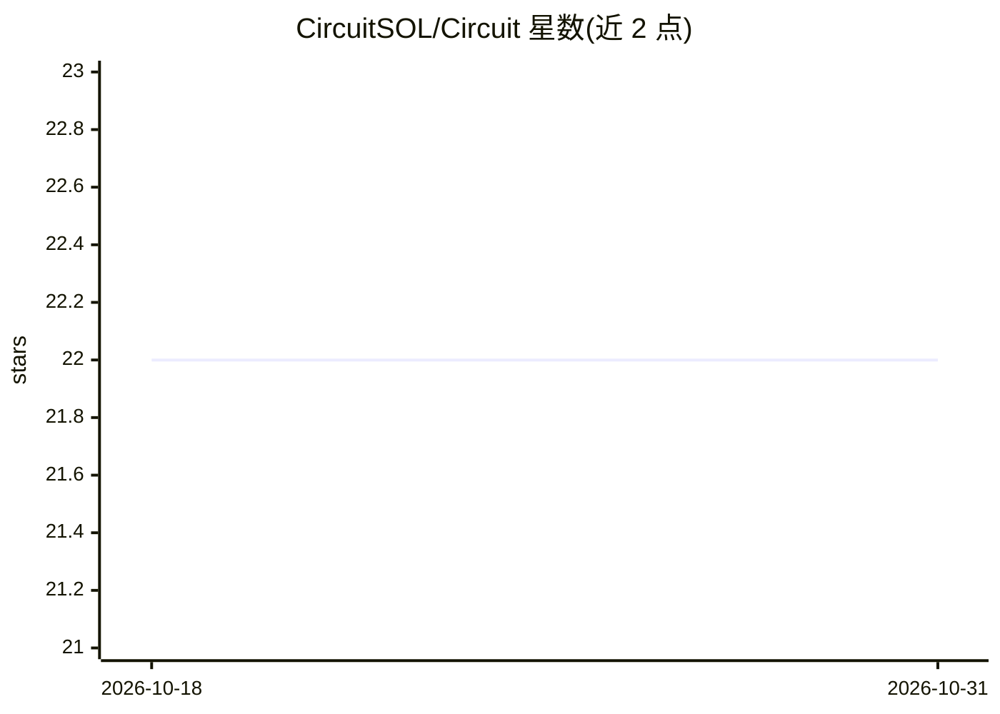

# CircuitSOL/Circuit

⭐ 22 · TypeScript · MIT · 推送 2026-07-13 · [GitHub](https://github.com/CircuitSOL/Circuit) · 组织维护

**Solana 杠杆仓位的清算防御断路器：分级告警与行动建议**

面向 Kamino 与 MarginFi 借贷敞口运营者的清算防御监控层：按周期拉取钱包借贷仓位，计算健康因子、清算距离与仓位级风险，映射为 SAFE/WATCH/WARNING/CRITICAL 四级防御状态并输出对应响应（监控/减债/加抵押/清仓退出）。auto-exit 默认关闭，可先以仅告警模式运行。基于 Claude Agent SDK 构建，配置需 ANTHROPIC_API_KEY，通过 bun 从源码运行。

## 筛选速览

| 维度 | 判定 | 备注 |
|---|---|---|
| AI 角色 | `ai-enhanced` | 去掉 AI 部分产品仍成立 |
| 许可风险 | `permissive` | MIT |
| 部署形态 | `None` |  |
| 模型依赖 | — | README 未给出锁定关系 |
| 硬件要求 | — | 无带数字的原话,不猜 |
| 安装摩擦 | `low` | 无编译、无系统依赖或容器化 |
| 成熟度 | — | 结构信号不足 |

## 能力要点

- FETCH→ASSESS→CLASSIFY→MATCH RULES→RESPOND 防御循环，默认 15 秒轮询
- 四级风险状态（SAFE/WATCH/WARNING/CRITICAL）各绑定明确健康阈值与响应动作
- auto-exit 默认关闭，支持仅告警模式与策略校验阶段
- 仓位级建议附着于具体仓位而非通用市场告警

## 适用场景

- 监控 Solana 借贷仓位健康度漂移，在清算风险临近前获得分级告警
- 启用自动退出前先验证告警阶梯是否符合自身风险判断
- 作为常驻控制层审计杠杆仓位的阈值与仓位规模是否仍可接受

## 场景标签

 · 领域:DeFi/风险管理

## 证据(README 行号)

> L40: - `Use case`: liquidation defense for leveraged or borrowed Solana positions
> L74: 1. pull the latest supported lending positions for the monitored wallet

## 星数曲线

2026-10-18 22 → 2026-10-31 22（+0）

---
*卡片 v1 · prompt 1.4 · 生成 2026-10-28 · 置信度 mid · 依据 README sha `b544a1b9c998` · [字段定义](../../DATASET.md)*
