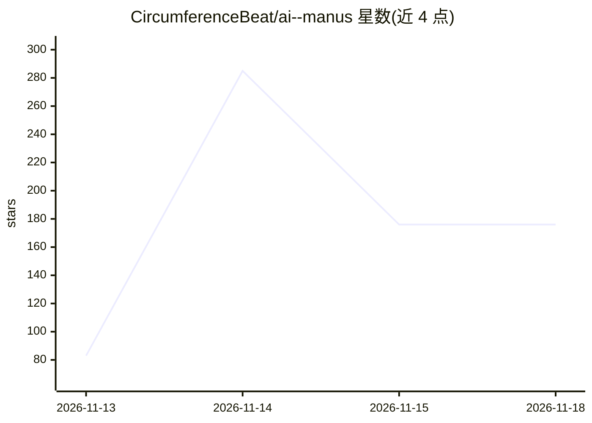

# CircumferenceBeat/ai--manus

⭐ 176 · Apache-2.0 · 推送 2026-11-15 · [GitHub](https://github.com/CircumferenceBeat/ai--manus) · 个人维护

**面向日常任务的自主 AI Agent：自动写代码并控制浏览器**

自称 Manus 的自主 AI Agent 系统，描述中称支持在沙箱环境运行多种工具与操作，面向家庭、学习与轻量办公场景。README 宣称的能力包括：自主编写并执行脚本、控制浏览器完成页面导航/表单填写/信息收集、多步骤任务执行与跨会话保持模式。README 提供系统兼容性表（最低 4GB 内存、双核 CPU）与使用步骤说明，但未给出任何安装命令、依赖清单或源码结构，内容以功能描述与搜索关键词为主，可验证的技术细节有限。

## 筛选速览

| 维度 | 判定 | 备注 |
|---|---|---|
| AI 角色 | `ai-native` | 本体是模型或模型工具 |
| 许可风险 | `permissive` | Apache-2.0 |
| 部署形态 | `None` |  |
| 模型依赖 | — | README 未给出锁定关系 |
| 硬件要求 | — | 无带数字的原话,不猜 |
| 安装摩擦 | `low` | 无编译、无系统依赖或容器化 |
| 成熟度 | — | 结构信号不足 |

## 能力要点

- 自主编写并执行代码以完成任务
- 浏览器控制：导航网页、填写表单、收集信息
- 代码与浏览器操作可在同一流程内衔接
- README 列出系统兼容性要求（最低双核 CPU / 4GB RAM）

## 适用场景

- 让 agent 代为执行重复性的脚本与网页操作
- 学习与研究中收集资料、整理笔记
- 轻量办公中跨多个页面汇总信息

## 场景标签

`浏览器自动化` `AI 助手` · 领域:效率与自动化

## 证据(README 行号)

> L10: - **Autonomous Code Execution:** Manus AI agent runs code on its own to complete tasks, so you can focus on decisio
> L18: Manus is an autonomous AI agent designed to run code and control a browser on your behalf. Instead of acting like a

## 星数曲线

2026-11-13 83 → 2026-11-18 176（+93）

---
*卡片 v1 · prompt 1.4 · 生成 2026-11-17 · 置信度 low · 依据 README sha `0f78ee3a5dd2` · [字段定义](../../DATASET.md)*
