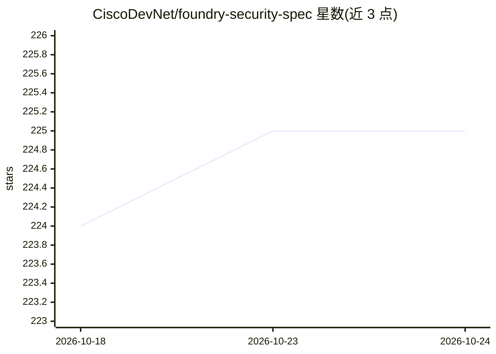

# CiscoDevNet/foundry-security-spec

⭐ 225 · NOASSERTION · 推送 2026-05-12 · [GitHub](https://github.com/CiscoDevNet/foundry-security-spec) · 组织维护

**agentic AI 安全评估系统的开放规格书（Cisco，无代码）**

Cisco 高级安全倡议组将内部多轮迭代的 agentic 安全评估系统设计提炼为组织中立的开源规格：含 8 个核心 agent 角色、5 个扩展角色、finding 生命周期、协调与治理模型、约 130 条功能需求及 11 条不可违背原则，约三打组织相关决策点标记为 [NEEDS CLARIFICATION] 留给使用者。仓库刻意不含代码，交付物即规格本身；通过 spec-kit 工作流（Claude Code 或兼容 coding agent）完成澄清、规格化与实施。检测规则格式配套采用 Cisco 捐给 CoSAI 的 CodeGuard，可用其他格式替代。面向安全团队、平台/工具团队与研究者，非开箱即用扫描器。

## 筛选速览

| 维度 | 判定 | 备注 |
|---|---|---|
| AI 角色 | `ai-knowledge` | 知识聚合/清单类 |
| 许可风险 | `none` | NOASSERTION |
| 部署形态 | `library` | 以包/库形式分发 |
| 模型依赖 | — | README 未给出锁定关系 |
| 硬件要求 | — | 无带数字的原话,不猜 |
| 安装摩擦 | `low` | 无编译、无系统依赖或容器化 |
| 成熟度 | — | 结构信号不足 |

## 能力要点

- 规格含 8 核心 + 5 扩展 agent 角色与约 130 条功能需求，附设计理由
- 11 条不可违背原则，各对应一次生产环境故障
- detection-to-prevention 飞轮：探索 agent 发现规则缺口→规则入库→下轮扫描全类命中
- 刻意不含代码，需用户自带 frontier LLM 在自有技术栈上实现

## 适用场景

- 安全团队基于规格在自有基础设施上构建可信任的 agentic 安全评估系统
- 平台/工具团队从已验证的系统形态出发搭建内部安全评估能力
- 研究者参考基于生产运营而非基准测试的 AI 辅助漏洞发现架构

## 场景标签

`网络安全` `模型评测` · 领域:评测与运维

## 证据(README 行号)

> L22: There is **no code** in this repository, and that is intentional. The specification is the deliverable.
> L9: **Foundry distills that experience into a single, organization-neutral specification.** It is the design that, acros

## 星数曲线

2026-10-18 224 → 2026-10-24 225（+1）

---
*卡片 v1 · prompt 1.4 · 生成 2026-10-22 · 置信度 mid · 依据 README sha `f10169aa86e2` · [字段定义](../../DATASET.md)*
