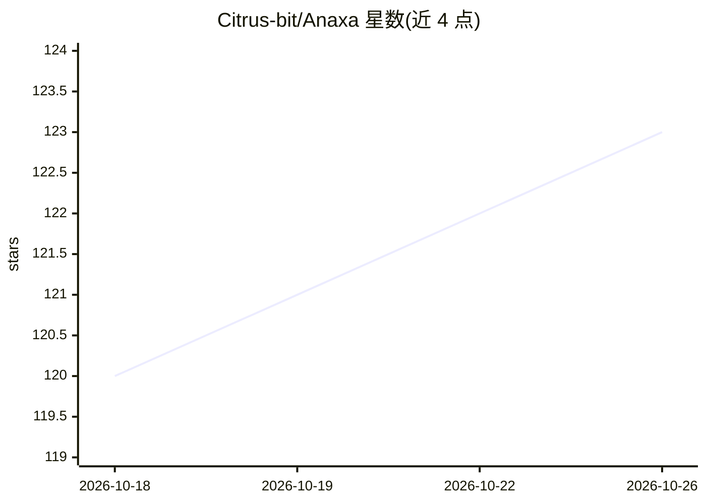

# Citrus-bit/Anaxa

⭐ 123 · Python · MIT · 推送 2026-09-07 · [GitHub](https://github.com/Citrus-bit/Anaxa) · 个人维护 · 中文 README

**科研智能体工作台：文献检索到论文成稿的可追踪研究生命周期**

面向科研工作流的开源智能体系统，将文献检索、claim 级证据映射、实验执行、LaTeX 论文写作、质量审计与 PDF 导出串联进以 ResearchQuest 组织的可恢复研究链路。每阶段输入输出写入研究 ledger，外部代码执行、长实验和论文发布默认需人工 gate。文献来源覆盖 Semantic Scholar、OpenAlex、arXiv 等，实验侧覆盖 CS/AI 与生物信息任务。后端为 FastAPI + LangGraph Server，前端 Next.js，通过 Nginx 统一入口；源码与 Docker 两种方式部署，模型 provider 由用户在前端自行配置 API Key。开源开发版默认无 UI 密码，不适用于公网生产。

## 筛选速览

| 维度 | 判定 | 备注 |
|---|---|---|
| AI 角色 | `ai-native` | 本体是模型或模型工具 |
| 许可风险 | `permissive` | MIT |
| 部署形态 | `self-host` | docker 或自建部署 |
| 模型依赖 | — | README 未给出锁定关系 |
| 硬件要求 | — | 无带数字的原话,不猜 |
| 安装摩擦 | `low` | 无编译、无系统依赖或容器化 |
| 成熟度 | — | 结构信号不足 |

## 能力要点

- claim→paper_id→证据片段的 claim-level 证据绑定与 citation_audit
- ResearchQuest 阶段化研究链路，高风险步骤默认 human gate
- 两段式论文交付：manuscript_draft 初稿 + 后台 finalization 编译 PDF bundle
- 多源学术检索（Semantic Scholar/OpenAlex/Crossref/arXiv 等）与 GB/T 7714 等 6 种引用格式

## 适用场景

- 做系统综述、相关工作调研并整理参考文献
- 把论文草稿的每个论断绑定到具体文献证据
- 运行可复现实验并一键导出 LaTeX/PDF 论文 bundle
- 在长科研任务中阶段性人工审查和接管自动化流程

## 场景标签

`科研工具` `多智能体` `AI 写作` · 领域:Agent 开发

## 证据(README 行号)

> L19: Anaxa 是一个面向科研工作流的开源智能体系统。它不是普通聊天机器人，也不是无人监管的论文生成器，而是把文献检索、证据审计、实验执行、论文写作、同行评审式检查和最终产物整理串联到同一个可追踪的研究生命周期中。
> L21: 系统的核心目标，是把科研任务从“在对话里临时生成一段文字”推进到“每一步都有来源、产物、状态和人工接管点”的工作台。普通聊天仍然是入口，但复杂研究任务会被路由到后端的学术检索、实验、论文导出和研究编排工具。
> L56: 论文生成默认采用“两段式”交付：`research_assistant action="run_pipeline"` 会先在 `manuscript_draft` 阶段返回可编辑初稿和 fast draft `.tex`，并记录 

## 星数曲线

2026-10-18 120 → 2026-10-26 123（+3）

---
*卡片 v1 · prompt 1.4 · 生成 2026-10-23 · 置信度 high · 依据 README sha `095338e357e4` · [字段定义](../../DATASET.md)*
