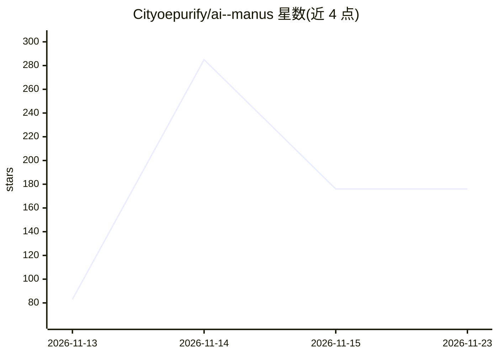

# Cityoepurify/ai--manus

⭐ 176 · Apache-2.0 · 推送 2026-11-15 · [GitHub](https://github.com/Cityoepurify/ai--manus) · 个人维护

**面向个人用户的自主 AI Agent：代为执行代码与浏览器操作**

Manus 是一个自主 AI Agent，定位为家庭、学习与轻量办公场景的个人助手：用户用自然语言下达指令，Agent 自行编写并执行脚本、控制浏览器（导航、填表、抓取信息）、完成多步骤任务，并可在后台持续运行与跨会话复用工作流。README 为功能介绍与使用引导性质，给出硬件兼容表（最低双核 CPU / 4 GB 内存）与上手步骤，但未提供具体的安装命令、技术架构或模型接入说明；页面含下载入口与促销代码 PROMO2026。

## 筛选速览

| 维度 | 判定 | 备注 |
|---|---|---|
| AI 角色 | `ai-native` | 本体是模型或模型工具 |
| 许可风险 | `permissive` | Apache-2.0 |
| 部署形态 | `None` |  |
| 模型依赖 | — | README 未给出锁定关系 |
| 硬件要求 | — | 无带数字的原话,不猜 |
| 安装摩擦 | `low` | 无编译、无系统依赖或容器化 |
| 成熟度 | — | 结构信号不足 |

## 能力要点

- 自主执行代码：Agent 自行编写并运行脚本完成任务
- 浏览器控制：导航网页、填写表单、收集信息
- 多步骤任务与跨会话的工作流复用
- 面向家庭/学习/轻办公的小规模场景设计

## 适用场景

- 让学生整理研究笔记、跑快速计算
- 让 Agent 汇总多个网页的信息准备小报告
- 把重复性的文件检查、表单填写等杂务交给后台 Agent

## 场景标签

`AI 助手` `浏览器自动化` `工作流自动化` · 领域:效率与自动化

## 证据(README 行号)

> L18: Manus is an autonomous AI agent designed to run code and control a browser on your behalf. Instead of acting like a
> L22: Manus is not a heavy studio suite or a complex enterprise platform. It is a focused helper built for home, study, a

## 星数曲线

2026-11-13 83 → 2026-11-23 176（+93）

---
*卡片 v1 · prompt 1.4 · 生成 2026-11-17 · 置信度 mid · 依据 README sha `0f78ee3a5dd2` · [字段定义](../../DATASET.md)*
