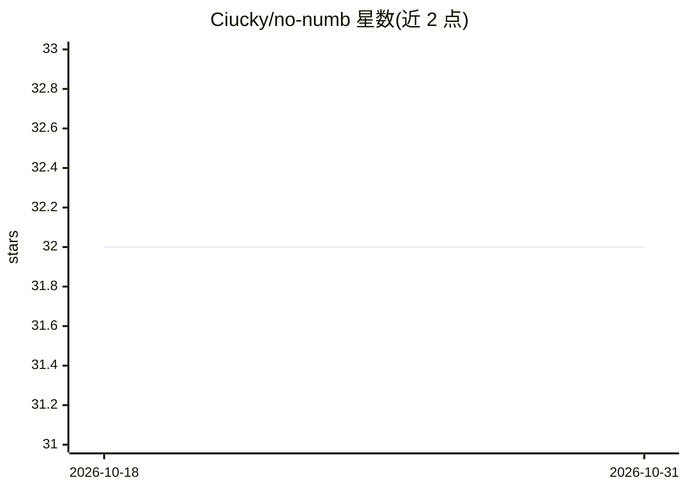

# Ciucky/no-numb

⭐ 32 · Shell · 推送 2026-06-19 · [GitHub](https://github.com/Ciucky/no-numb) · 个人维护

**Claude Code 插件：对刚写的代码提问并闸住会话直到答对**

面向 Claude Code 用户的插件：通过 Stop hook 在 Claude 完成含文件编辑的一轮后，让其基于本轮上下文生成选择题，逐题作答，答错显示正确答案并解释后重测，通过前会话不继续，Esc 可主动跳过。配置仅 ~/.no-numb/config.json 两个键（enabled、depth），depth 分 standard/deep 两档，deep 需读代码作答。另提供 /no-numb:quiz-me 主动自测命令。注意点：每轮额外消耗 token；随附 Bash hook 脚本 gate.sh，README 提示安装前审阅源码。

## 筛选速览

| 维度 | 判定 | 备注 |
|---|---|---|
| AI 角色 | `ai-ecosystem` | LLM/agent 周边工具 |
| 许可风险 | `none` | — |
| 部署形态 | `None` |  |
| 模型依赖 | locked-api |  |
| 硬件要求 | — | 无带数字的原话,不猜 |
| 安装摩擦 | `low` | 无编译、无系统依赖或容器化 |
| 成熟度 | — | 结构信号不足 |

## 能力要点

- Stop hook 在编辑回合后触发基于本轮上下文的选择题测验
- 答错显示正确答案并解释，重测直到通过才会话继续
- depth 两档：standard（基于决策理解）/ deep（需读代码作答）
- /no-numb:quiz-me 提供不带闸门的主动自测

## 适用场景

- 用 Claude Code 开发时强制自己理解 AI 写的代码
- 通过测验式复习巩固本轮改动的设计原因与失败模式
- 截止日临时关闭闸门，用自愿模式代替强制测验

## 场景标签

 · 领域:开发者工具/AI 辅助编程

## 证据(README 行号)

> L3: **Build with Claude Code without your brain going numb.** No-Numb quizzes you on the code Claude just wrote — and, b
> L20: 2. When Claude finishes a turn in which it **edited or wrote a file**, a `Stop` hook intercepts and has Claude gene
> L61: **Prerequisites:** Claude Code with plugin support, and `jq` on your PATH (the hook uses it).

## 星数曲线

2026-10-18 32 → 2026-10-31 32（+0）

---
*卡片 v1 · prompt 1.4 · 生成 2026-10-26 · 置信度 high · 依据 README sha `7f7e28ef969b` · [字段定义](../../DATASET.md)*
